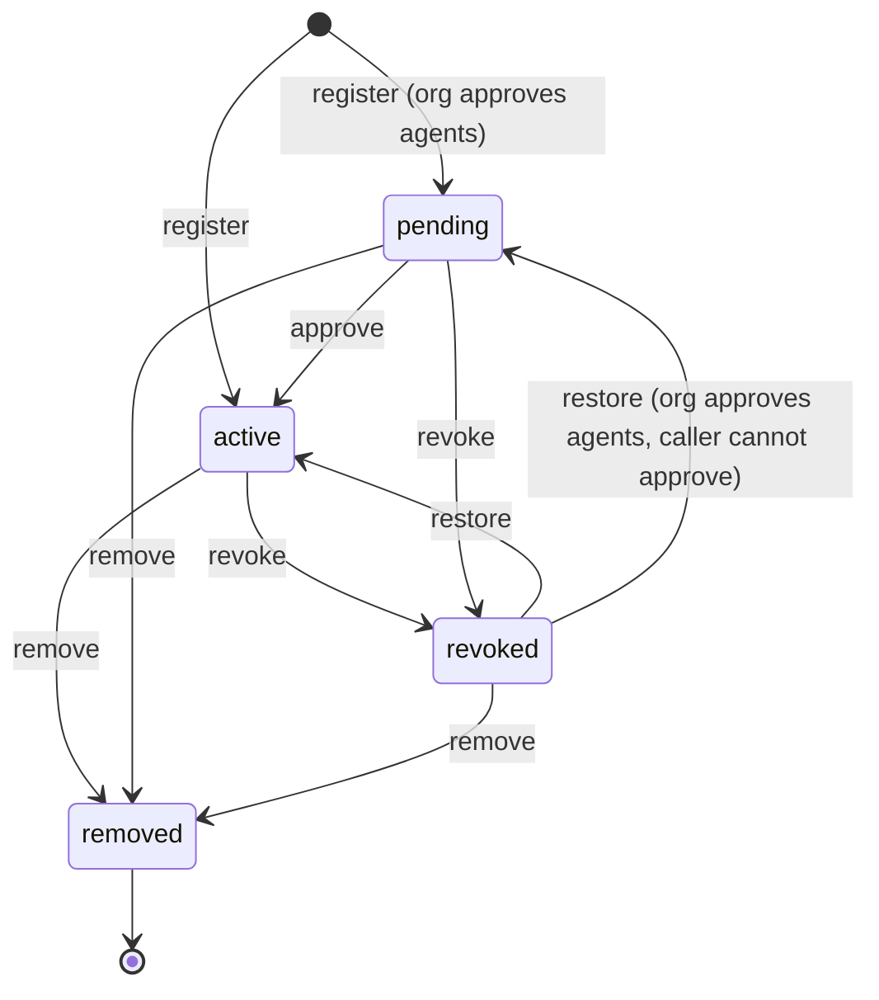

# Agents: identity, owner rights, agent rights and joining projects

## 1. Purpose

Every agent acts as itself, never as a person, and only within the current rights of the user who owns it. What it may do in a project is a set of rights (work, ready, triage, answer, decide), given to the agent or to one of its chats. A chat of a harness the CLI recognises gets its own agent from its human's CLI login, and asks once per project before it works there. Card work itself is in `board.md`; the dashboard screens for the settings below are in `dashboard.md` 2.14.

## 2. Behaviour

### 2.1 An agent's identity in the CLI

- A chat of a recognised harness is one whose session variable is set (`sessionHarnesses` in `internal/cli/session.go`: Claude Code, OpenCode, Codex, pi, Qwen Code, Copilot CLI, dsh, Goose). Its commands act as the agent `<harness>@<machine>` (`agentName` in `internal/cli/identity.go`: the hostname with `/` and `\` replaced by `-`, cut to 64 bytes). The CLI's `copilot` is the server's `copilot-cli`.
- `LORVIK_CONFIG` or `LORVIK_TOKEN` turns this off, and the CLI uses that credential as before. When `LORVIK_CONFIG` names a file whose `harness` key differs from the detected harness, each command warns on stderr, naming the agent the chat acts as (#237 A).
- The agent's file is `agents/<name>.toml` beside the user config, mode 0600: `api_url`, `agent_id`, `agent`, `harness`, `token`, `token_expires_at` (RFC 3339), `joined` (comma-separated slugs) and the inbox cursors keyed by token. Your own config is never written by an agent's command. A file written for another server than your login's is ignored and replaced.
- The first command registers the agent from your login (`POST /agents` with `auto`) and prints `registered agent <name> ...` on stderr. Later commands use the agent's token, and renew it from your login (`POST /tokens {agent}`) once it has 10 minutes or less to live (`renewBefore`). Registration and renewal hold the agent file's lock and look again once they hold it, so chats starting together register one agent and mint one token. When the server refuses the agent token (401) though this machine's clock calls it fresh, as when the clock runs behind the server's, the CLI renews once, skipping the refused token, and sends the request again. `inbox --follow` renews before every read, and `watch` renews and reopens the stream from its last position when the server ends it with the token, so both outlive the token.
- When the agent file is lost but the server knows the agent, registration answers 409 and the CLI finds the caller's own agent of that name and mints it a token. Another user's agent of the same name is exit 4 (`another user's agent is named ...`). A revoked agent is never registered again by a chat: renewal answers 409 and the command fails with the server's hint, which names the two ways out for its owner, restore and remove (2.7).
- With nobody signed in, a harness chat stops with exit 5 before sending anything and names `lorvik login`; it never falls back to your token.
- Before the first command in a project after each renewal, the CLI asks to join it (`POST /projects/{slug}/join`, 2.3). `joined` prints the server's message on stderr; `pending` stops the command with exit 5 and the message (`waiting for <owner> to allow <agent> in <project> on the dashboard`); the slug is added to `joined` once the agent is in.
- `lorvik agent register` stays for other harnesses and unattended agents: it prints the token, which lives at most an hour (2.2).
- The CLI sends the chat's name (2.6) as `X-Lorvik-Session-Name` on every request, from the first of these that gives one (`chatName` in `internal/cli/sessionname.go`, #321):

  | Source | When | Where it is changed |
  |---|---|---|
  | `LORVIK_SESSION_NAME` | set and not blank | the variable |
  | The harness's own chat name | Claude Code: `name` in `<CLAUDE_CONFIG_DIR or ~/.claude>/sessions/<pid>.json`, the file of `CLAUDE_PID` or else of the nearest ancestor process, used only when its `sessionId` is the chat's `CLAUDE_CODE_SESSION_ID` | the chat, in the harness |
  | None | any other chat | `lorvik session name "<text>"` stores one (`PUT /me/session-name`), `--clear` removes it |

  A rename in Claude Code therefore reaches the board with the chat's next command. Further rules:

  - `lorvik session name` in a chat whose name comes from one of the first two rows is refused with exit 4 and says where to change it: the name it stored would be replaced by the next command.
  - `session_names = "off"` in the user config sends no name from any source and refuses `lorvik session name "<text>"`; `--clear` still works. The switch fails closed: any value other than `"on"` or `true`, and a config file that cannot be read, count as off.
  - The name goes only on requests that carry a token, so a `.lorvik.toml` in a cloned repo that names another server gets neither (the token rule is `Settings.credential`).
  - The name is sent with control characters turned into spaces, white space collapsed, and cut to 400 bytes; the server applies the storing rule (2.6).
  - Claude Code's session file is its own undocumented state (seen in 2.1.311): a missing file, another chat's id or an unreadable one means no name, never an error. `CLAUDE_PID` is missing in some of its child processes and can be another chat's, so the id is always compared. The ancestor search goes through shells and stops at the first process that is not one; a command launched through something else sends no name, and the server keeps the one it has. This bounds the cost where a process lookup runs `ps` (macOS).
  - `lorvik session` prints the name and its source without contacting the server. `lorvik who`, card lines and lock lines print a named chat as the dashboard does (`ChatLabel`, `HolderChat` in `internal/cli/cmdutil`).

### 2.2 Agent tokens

- An agent token lives at most an hour (`domain.AgentTokenTTL`). `POST /agents` and `POST /tokens {agent}` mint that by default; a shorter `expires_in` is kept and a longer one is 422. A request with an agent token issued for longer, including every token minted before this rule, is 401 `agent token outlives the one-hour limit`, with a hint naming the harness identity and `lorvik token create --agent <id>` (#245, answer 2).
- Agent tokens are never rotated by the server: rotation needs a token living at least twice `TokenRotationWindow`.
- A revoked agent gets no new token: `POST /tokens {agent}` is 409 `agent revoked: <name>`. A request with a token of a revoked agent is 401 `agent revoked`, not `token revoked`, so the agent does not go looking for another token.
- A removed agent is unknown to the token route: `POST /tokens {agent}` is 404, and a request with one of its tokens is 401 `token revoked`. The CLI therefore renews, hears 404 and registers a new agent (2.1, 2.7).

### 2.3 Owner rights

Every request with an agent token checks the owner (`agentOwner` in `internal/server/principal.go`), so an agent never does what its owner could not do now (#245, answer 1):

- Owner suspended: 403 `agent's owner is suspended`. Owner deleted: 401 `agent's owner is deleted`. Owner no longer a member of the org: 403 `agent's owner is not a member of this org`.
- The agent's org rights are only those its owner's org role holds (`domain.RightsHeldBy`).
- In a project the agent holds its rights there (2.6), only those its owner's role there holds (`roleIn`, `projectStandings`, `held.underOwner`); a project its owner cannot see is 404 to the agent too. Assigning a card to an agent checks that it sees the project.
- An open event stream runs the same checks (`Service.standing`, shared with the auth middleware) and recomputes its projects on every wake and poll, and once more when its token expires; it ends as soon as they fail and sends nothing after. This holds for users too: a suspended or removed user's stream ends.

### 2.4 Joining a project

- `POST /projects/{slug}/join`, agents only. With a row there it answers `member`. Otherwise four says decide (`domain.DecideAgentJoin`): `ask` from any say wins, then `allow` from any, else ask.
  - The agent's own setting: follow, allow in all its owner's projects, or always ask.
  - The owner's rule for this project: allow or always ask; none is follow.
  - The project admin's setting: follow, or every agent always asks here.
  - The owner's account switch: follow (off) or allow.
- Allowed, the agent joins with the work right and `agent.joined` is written with `auto`. The row stores work whatever the owner is; the owner's role caps it on every request (2.3), so an agent that joined under a viewer owner holds nothing until the owner is promoted, with no one editing its rights. `JoinResult.rights`, the messages and the event payloads report the rights it holds now. Otherwise a pending request is stored and `agent.join_requested` written; asking again while it is pending writes nothing. A project the owner cannot see is 404. An agent its owner denied or removed there is 403 until the owner adds it back, so it cannot ask again.
- The owner sees pending requests on the dashboard's awaiting list (`GET /agent-requests`), oldest first, only for active agents in projects the owner can still see. Allow (`PUT /agent-requests/{id}/{slug}`) lets the agent in with work, reported as the owner's role there holds it now, and writes `agent.joined`; Deny (`DELETE`) writes `agent.join_denied`. Revoking the agent removes its pending requests. Anyone but the owner gets 404. "Allow in all my projects" sets the agent's own setting to allow (`PATCH /agents/{id}`, `agent.updated`).

### 2.5 Registration

- `POST /agents` with `auto` is the CLI registering a harness itself: it takes no projects and no org role, so the agent reaches a project only by joining it (2.4). It is 409 with a hint when a revoked agent of that name by the caller exists; a removed one does not count. Under `agent_approval=admin` it stays pending whoever registers it, an admin included.
- A plain `POST /agents` binds the projects given, at no higher role than the caller holds there.

### 2.6 Rights and chat grants

- An agent's membership rows hold viewer; its rights carry the rest (`domain.Rights`, table in `docs/api.md`, Agent rights): work, ready, triage, answer, decide, in any combination. Decide lets the agent accept or reject a proposed decision for its owner, within the bars of `decisions.md` 2.3; like the others it is given only by name (join and Allow give work alone) and only by someone whose own role holds decision accept. Revoking a decision, recording one as accepted, `decide` on an answer, claim override and every admin and owner verb stay human-only.
- Rights in a project: the project row's, plus the org membership's where the project lets the org role apply, plus the chat's grant, then only those the owner's role there holds. `access.can` is the one check.
- Granting: join and Allow give work. `agent register --rights`, `agent bind --rights`, `member add` and `project member add` with an agent target give named rights, none beyond what the granter's role there holds (422 on `rights`). A body naming neither role nor rights gives work; `role: viewer` without rights is 422 on `rights`, since viewer alone gives none. An agent row with a role other than viewer, or a person with rights, is 422. `lorvik member role` is for people: given an agent it is a usage error naming `member add --rights`.
- A chat is its session label (`X-Lorvik-Session`, derived per chat by the CLI). Every request of an agent with a label records its base label (`domain.BaseSession`: `-c<n>` subagent suffixes stripped) in `agent_sessions`, at most once a minute (an in-memory gate per agent and base label in front of the SQL one). Neither grows without bound however many labels a token sends (#327): the in-memory gate holds at most the chats and tokens of the last day and forgets a token or chat with no request for a day (a sweep at most once an hour, `internal/server/auth.go`), and when a chat the gate does not hold makes a request, the agent's rows are trimmed to the 1,000 most recently seen, keeping besides every chat that holds a grant, so a duty is never lost (`TrimAgentSessions`). Nothing is refused: a trimmed chat that comes back is recorded again, with no name until its client sends one. A generated label is `<word>-<word>-<4 hex>`, and `BaseSession` stops stripping once what is left has that shape, so `witty-lynx-c123` is a chat and `witty-lynx-c123-c5` is its subagent. `GET /agents/{id}` lists the 20 most recent with their grants, plus every chat that holds a grant, however old or never seen (those come last, without `last_seen_at`).
- A chat may carry a name, what people call it, beside its label (#320 A, #321). Nothing is keyed by it: claims, grants and locks stay on the label, so a rename changes only what people read. The server keeps one name per chat (`agent_sessions.name`), the last one it was sent: by `X-Lorvik-Session-Name` on any request of the chat, stored with the once-a-minute touch and at once when it differs from the last one sent, or by `PUT /me/session-name` for a chat whose client has none to send. Names are cleaned, never refused (`domain.CleanSessionName`: control characters become a space, zero-width characters and direction overrides are dropped so a name can neither be invisible nor reorder the text around it, at most 60 characters); only the route refuses a body over 400 characters. A request without the header leaves the stored name alone. Everyone who can see a chat's label sees its name: the holder of a card or lock, the live claims, the agent's chats on the Access page. It is returned wherever the label is: `session_name` on a card's claim, the live claims and a lock, `name` on `GET /agents/{id}` sessions, `session_name` on the agent's own `/me`. A subagent's request names its chat. Where the name comes from on the client is in 2.1.
- `PUT /agents/{id}/sessions/{label}/projects/{slug}` gives that chat, and its `-c<n>` subagents, rights in one project on top of the agent's; `DELETE` takes them back. The owner or an agent manager only (else 404), a base label only (422 on `label`), a project the agent sees (422), rights the caller's role there holds. Each writes `agent.session_rights`.
- A grant may carry an end (`ends_at`) and the owner's instructions to the chat (`instructions`, at most 4,000 characters, trimmed), decided on #384. From its end on the grant gives nothing, whether or not its row was settled yet (`AgentSessionGrant.Live` is the one check, used by `access`, the project list and the agent's detail). The sweeper then sets the row to removed and writes one `agent.session_rights` with empty rights and `ended_at`, with the agent as actor in the unprompted session; a grant extended or taken back meanwhile is left alone (`EndAgentSessionGrant` updates only a row still alive and past its end). An end that is not in the future is 422 on `ends_at`. The event of a grant carries `ends_at` when it has one; the instructions are not in any event.
- The chat reads its grant from `GET /projects/{slug}` (`chat_grant`), which `lorvik status` prints: `this chat was given answer, ready, ending in 7h`, then the instructions. No other chat and no person gets `chat_grant`.
- The instructions are their giver's words to one chat. In `GET /agents/{id}` (and the agent returned by a change) a grant carries them only for a caller who may manage the agent, its creator or a holder of agent manage; every other reader of the org, another agent and another chat of the same agent included, gets the grant's project, rights and end with no `instructions` (`agentDetail`). The same readers get the agent's `projects` and its chats' grants only in projects they can see themselves (`visibleProjects`): a private project they are not in is named to no one but its members and who may manage the agent.
- Several chats of one agent can be on duty at once, in one project or in several: a grant is per chat and project, and nothing limits their number.
- What a chat settles under a grant is settled for the agent's owner (`Principal.Owner`), whoever gave the grant: an agent manager who puts another person's agent on duty hands on rights of their own, and the owner is the one who keeps or changes the result. `agent_session_grants.granted_by_user_id` records the giver; the API does not return it.
- A change to what a chat was given wakes that chat and its subagents, and no other (`chatGrantChanged` in `markMineWake`): the grant, its taking back, and its end. The chat acts on those rights, so it is the one to hear they began or stopped.
- A chat's grant ends with the agent's place in its project: unbinding the agent, removing its project membership, removing its org membership or revoking it sets every alive grant (in that project; in all for the last two) to removed in the same transaction, one `agent.session_rights` with empty rights per grant. Binding it again starts with no chat grants.
- Creating a task or story already in ready needs the ready right, except a child of a story past backlog: readying the story authorized its work (`requireCreateReady`, decided on #273). Questions and proposed decisions start ready under work as before. A question such an agent links as blocking a backlog card leaves that card in backlog rather than parking it, since the answer or an unlink would ready it.
- A chat with the answer right cannot answer a question that it or one of its `-c<n>` subagents asked: the question's `card.created` event carries the asking label, and equal base labels (both empty included) are 403 with a hint to leave it to another chat or a person, or to relay the human's answer (`refuseOwnQuestion`, decided on #273). Relaying is unaffected.
- A refused agent hears `agent <name> lacks the <right> right in <slug>`, with a hint naming its chat's label.

### 2.7 Revoke, restore and remove

An agent is stopped in two ways, and one of them can be undone.

| Action | Route | What it does | Undo |
|---|---|---|---|
| Revoke | `DELETE /agents/{id}` | Revokes its tokens, clears its assignments on open cards, ends its chats' grants, drops its waiting join requests. Its project and org access rows stay. Its name is free, but a chat of the same owner cannot register that name again (2.5). | Restore |
| Restore | `POST /agents/{id}/restore` | Makes a revoked agent active again with the access rows it had. Tokens, assignments and chat grants stay gone; its chats get a new token on their next command (the old one answers `token revoked`, so the CLI renews). | Revoke |
| Remove | `POST /agents/{id}/remove` | Stops an agent of any status as a revoke does, then sets its project and org access to removed and its status to removed (-20). It is in no list, `all` included, and no route changes it or gives it a place again: the agent routes answer 404 and the member routes (`PUT /members/agent/{id}`, `PUT /projects/{slug}/members/agent/{id}`) 422 `no such agent in this org`. `GET /agents/{id}` and `GET /actors` still name it, so its past work reads the same. | None |

- Who: revoke and remove take the agent's owner or a user with agent manage. Restore takes the same and the agent register permission. Never an agent.
- The owner may restore an agent whoever revoked it, an admin included: who revoked is not stored. The restored agent still acts only within its owner's current rights (2.3), and under `agent_approval=admin` it waits for an agent manager. An admin who wants a member's agents gone for longer takes the member role from the owner, or turns approval on.
- Every route that reads an agent's status and then writes the agent, its access or a token for it locks the agent's row first (`lockAgent`, `SELECT ... FOR UPDATE`), so a restore, approval or token mint cannot land on top of a removal committed in between.
- Restore under `agent_approval=admin` by a caller without agent manage leaves the agent pending, as a registration by that caller would.
- Restore is 409 when the agent is not revoked, and 409 when a live agent holds its name by now.
- After a remove, the next chat of that harness on that machine registers a new agent: no access anywhere, pending where the org approves agents, and no link to the removed one's history.
- Events: `agent.revoked`, `agent.restored` (payload `status`), `agent.removed`.

### 2.8 Known defects

- A chat's name is as self-declared as its label: a chat of the same agent that sends another chat's label can also rename it, and a subagent's `LORVIK_SESSION_NAME` renames its parent chat. No other agent can. The name gives no access; it is only what people read.
- A join request that was waiting when its agent was revoked is stored as removed, the same as a denial, so after a restore the agent is refused in that project until its owner gives it access by hand.
- Two users signed in on machines with the same hostname collide on the agent name; the second gets exit 4 and has to use `LORVIK_CONFIG`.
- A chat's label is self-declared: another chat of the same agent that sets `LORVIK_SESSION` to it gets its grant. The skill forbids it; the server cannot tell.
- `GET /me` for an agent lists only projects it has a row in, so a chat grant in a project it reads through its org membership does not show there.
- The wake adapters under `skills/lorvik/adapters/` still start their listeners with an explicit `LORVIK_CONFIG`, so a harness started that way acts through that file rather than its own agent.

## 3. Rules

- An agent never acts under a human's token, and the CLI never sends your login on an agent's command: your token goes only to registration and renewal.
- Only the owner, or a user with agent manage, changes an agent's join setting or its chats' grants; never the agent itself. Only the owner decides the agent's requests.
- Every grant, request, denial and setting change writes an event, and every grant can be undone on the Access page.

## 4. Data

- `users.agent_join`: 0 follow (off), 10 allow.
- `agents.agent_join`: 0 follow, 10 allow in all the owner's projects, 20 always ask.
- `projects.agent_join`: 0 follow, 20 always ask (set by a project admin).
- `agent_join_rules(project_id, user_id)`: a user's own rule for their agents in one project, 10 allow or 20 always ask. No row is follow. It is a table of its own because org admins and owners often have no `project_members` row.
- A pending request is a `project_members` row of the agent with status 0 and `granted_by_user_id` the owner (`project_members_requests_idx`); denied or removed is -10.
- `agents.status`: 10 active, 0 pending, -10 revoked, -20 removed. `agents_name_key` covers status 0 and above, so both revoked and removed free the name.
- Events: `agent.restored` (100) and `agent.removed` (101); the fifties are full. `agent.join_requested` (53), `agent.joined` (54), `agent.join_denied` (55), `agent.updated` (56), `agent.join_setting` (57) when a user changes their account switch (no project) or their rule in one project (with it), and `agent.session_rights` (58). Agent payloads carry `rights` (older events `role`).
- `memberships.rights`, `project_members.rights`: an agent's rights bitmask (1 work, 2 ready, 4 triage, 8 answer, 16 decide); 0 for people.
- `agent_sessions(agent_id, session)`: base labels seen, with `last_seen_at` and `name` (null when the chat has none, never an empty string: every writer stores null for no name, #337 B). `agent_session_grants(project_id, agent_id, session)`: a chat's extra rights, status active or removed, with `ends_at` (null: until taken back) and `instructions` (null for none); a partial index on `ends_at` over alive rows serves the sweep.

## 5. API

Routes are in `docs/api.md` (Agents, Tokens, Projects, Me): `POST /projects/{slug}/join`, `GET /agent-requests`, `PUT` and `DELETE /agent-requests/{id}/{slug}`, `PATCH /agents/{id}`, `PATCH /me` and `PATCH /projects/{slug}` with `agent_join`, `PUT /projects/{slug}/agent-join`, `POST /agents/{id}/restore`, `POST /agents/{id}/remove`. Wire types: `JoinResult`, `AgentRequest`, `AgentCreated.token_expires_at` in `internal/apitypes`. The CLI calls the join, registration and token routes on its own (2.1); the dashboard uses the rest (`dashboard.md` 2.14).

## 6. Jobs

The sweeper (`RunSweeper`, every configured interval) takes back chat grants past their end (`endGrants`), each in a transaction of its own, 100 per pass. A second pass finds none.

## 7. Why it is this way

- Each harness gets its own agent from the human's login rather than by hand: a Codex chat acted as claude-code because a repo told every agent to export one file (#237, #238 D).
- First use of a project asks the owner on the dashboard, not in a terminal: the agent often has no terminal to ask on, and a command an agent can run is no consent (#246 A). Auto-allow exists at the account, agent and project levels because one switch for everything would also cover a harness used once (#247).
- Agent tokens live an hour and existing longer ones stop working: a leaked token is dead within the hour, and the CLI renews it at no cost to the human (#245, answer 2).
- A denied agent is refused rather than asking again, so it cannot nag its owner.
- Revoke blocks the harness from registering again and remove does not, because they answer different wishes: "this agent must stop until I say otherwise" and "start this agent over". Before remove existed a revoked harness agent could only come back through a hand registration, which made a second agent and left the first in the way.
- Who revoked an agent is not stored, so its owner may restore it after an admin's revoke (owner's decision, 2026-11-11). The owner could always register a replacement by hand, so a revoke was never a ban, and the restored agent stays within its owner's rights and the org's approval setting.
- Restore keeps tokens revoked: a revoke is often the answer to a leaked token, and a new one costs the owner nothing.
- Renewal reuses `POST /tokens {agent}` rather than a new route: the owner already mints agent tokens there.
- Rights replace agent roles, and chats get grants of their own, because the owner wants combinations a ladder cannot hold (ready and work without answer; answer alone) and one chat trusted more than its siblings (#270: R1 X S1). A chat grant covers its `-c<n>` subagents so their found work can be readied too.
