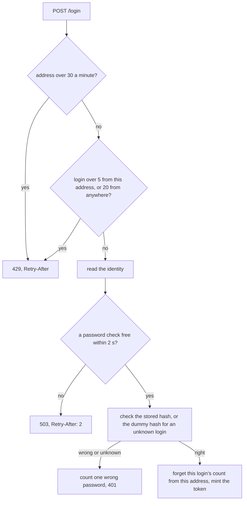
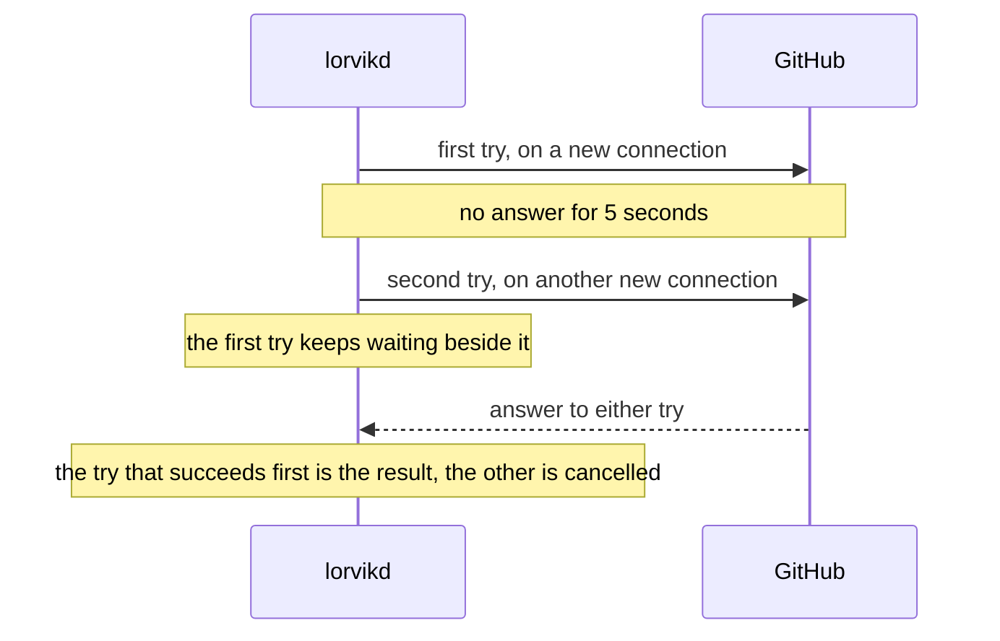
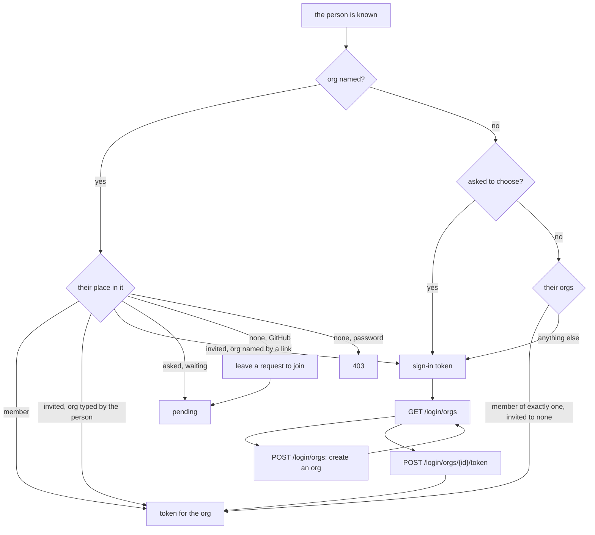

# Signing in: GitHub for humans, passwords for bootstrap

Sections 2 to 6 are implemented (story #4, cards #5, #6, #7, commit 1289106; 2.4a by card #39; the token check in 2.3 by #307; the server-held link, its events and unlinking in 2.4a by #306; the second try in 2.2a by #339; several orgs on one server and the sign-in token in 2.2b by #349; deleting your account in 2.4b by #419, closing an org with its only person by #423). Section 2.1 describes what was there before. Code: `internal/server/auth.go`, `internal/server/svc_tokens.go`, `internal/server/github.go`, `internal/server/github_link.go`, `internal/cli/login.go`, `web/src/views/LoginView.vue`, `web/src/views/AdminView.vue`.

## 1. Purpose

A server holds any number of orgs. A human signs in with GitHub and gets a token for their org; a person with no org creates one; an admin invites ahead by GitHub username, and a sign-in link that names an org lets a person ask to join it. Password login exists for the bootstrap user and development. Agents never sign in: they hold tokens minted for them, and a recognised harness's chat gets its own agent from the human's CLI login (`agents.md`).

## 2. Behaviour

### 2.1 Credentials, today

- Every request carries `Authorization: Bearer lvk_<u|a>_...`. There is no cookie session and no CSRF token; the dashboard keeps its bearer in browser storage (`lib/auth.ts`, key `lorvik.token`) and the CLI in its config file (`internal/cli/config.go`, key `token`).
- `POST /login` (`apitypes.Login`) is password login, public, answered only when the server runs with `LORVIK_AUTH_PASSWORD=true`; otherwise 404 "password login is disabled". A wrong login or password is 401 "wrong login or password" in both cases, with the same body and after the same password check (2.1a), so logins cannot be enumerated. Which org the token is for follows 2.2b; a named `org` the user is no member of and not invited to is 403 "not a member of that org".
- The Access page's "Your tokens" lists the user's active tokens, newest first, each with its prefix, name, scope, when it was created, when it was last used (or "never used"), when it expires and Revoke. Revoked and rotated tokens follow under "Revoked or replaced", without expiry or Revoke. Both lists share one grid (lists and rows are subgrids), so every column lines up across them (#285).
- The auth middleware refuses a pending org membership with 403 "membership pending approval" and a missing one with 403 "not a member of this org" (`auth.go`). A sign-in token (2.2b) is refused with 403 "no org chosen yet" on every route but `/login/orgs` and `DELETE /me` (2.4b).
- The CLI sends a token only to the server it is for (`Settings.credential` in `internal/cli/config.go`): the `api_url` saved beside it in the config file, else `--api-url`, `LORVIK_API_URL` or the default; for `LORVIK_TOKEN`, `--api-url` and `LORVIK_API_URL` come first. A repo's `.lorvik.toml` may name the server to talk to but never makes it the token's server, so a cloned repo naming another server gets no request: the command exits 5 with "<source> points at <url>, but your token is for <url>; no credential sent". Same server means same scheme, host and port. A redirect is followed only within the same server, on the event stream as on every other request (`client.stayOnOrigin`); Go's own rule would carry the header to another port, from https to http, or to a subdomain. (#239)
- Every sign-in (`lorvik login` in all three forms, and `lorvik init`'s inline sign-in) first checks the server (`trustBoundServer` in `internal/cli/login.go`). When it comes only from the repo's `.lorvik.toml` and is not the token's saved server, a terminal asks "This repo's .lorvik.toml (<path>) names <url>. Sign in to it?" (default no) before any password or GitHub step; without a terminal the command exits 5 with "<path> names <url>, not your saved server <url>; nothing sent. If you trust it, sign in with --api-url <url>". `--api-url` and `LORVIK_API_URL` skip the question. (#243, decided on #244)

### 2.1a Sign-in limits

The public sign-in routes are the only ones a stranger can call, and a password check is slow and memory-hungry on purpose (argon2id, `internal/domain/password.go`). Five rules bound what a stranger can make the server do. The numbers are constants in `internal/server/signin_limits.go`, not settings.

| # | Rule | Number | Refusal | What it stops |
|---|---|---|---|---|
| 1 | Password checks running at once | 4; a sign-in waits up to 2 seconds for one | 503 "sign-in is busy; try again in a few seconds", `Retry-After: 2` | a burst of sign-ins using more memory than the machine has |
| 2 | Wrong passwords for one login from one address | 5 in 15 minutes | 429 | one client guessing |
| 3 | Wrong passwords for one login from all addresses | 20 in an hour; one address counts toward it at most 5 times an hour | 429 | guessing from several addresses |
| 4 | Requests from one address to `POST /api/v1/login`, `POST /api/v1/login/github`, `GET /auth/github/start` and `GET /auth/github/callback`, counted together | 30 a minute | 429 | floods, on the GitHub routes too |
| 5 | An unknown login is checked against a dummy hash made with the current parameters | | | telling logins apart by response time |

- Rule 1 bounds memory at four times what one check takes. A check takes the memory written into the hash it reads: about 13 MiB with the parameters `internal/domain/password.go` sets now, so about 52 MiB for four. A hash stored under earlier parameters still verifies and takes its own, larger amount until that password is set again.
- A 429 is "too many sign-in attempts; try again in N minutes" (seconds under a minute) with `Retry-After` in seconds: the time until the oldest counted event leaves its window. The windows slide. On the two browser routes the 429 is plain text, on the API routes problem+json.
- A throttled attempt reads no database row and checks no password, whatever password it carries. Rules 2 and 3 count the login as typed (trimmed, lower-cased), whether it exists or not, so a throttled answer says nothing about which logins exist.
- A wrong password counts once the check has run. Only four checks run at once and the count is read again inside that bound, so requests sent together overshoot a limit by at most three.
- A right password forgets the wrong passwords this address sent for this login and nothing else. The count across all addresses stays until it runs out: clearing it would hand someone guessing from many addresses a fresh allowance each time the owner signs in. No count of another login is touched, so signing in to one's own account cannot reset the count on someone else's.
- A stored hash that cannot be read is refused like a wrong password, after the dummy check, and logged as an error for the operator.
- One address cannot fill rule 3 by itself: only its first 5 wrong passwords in an hour count toward it (rule 2 still bounds the rest). Without that share, an address kept just under rule 2 would reach 20 in 45 minutes and shut the owner out from every address. Cost: someone guessing from three addresses stays under rule 3 and gets 60 guesses an hour, not 20.
- Rule 3 lets someone with four or more addresses keep password sign-in for one login throttled for as long as they keep guessing. Nothing has to be undone afterwards: it ends within an hour of the last wrong password. Tokens already issued and GitHub sign-in keep working throughout.
- The client address is the peer of the TCP connection. Behind a reverse proxy that is the proxy, so `LORVIK_TRUSTED_PROXIES` (comma-separated IP addresses or CIDR ranges, default empty) lists the proxies whose `X-Forwarded-For` is believed: for a request from one of them the client is the nearest address in the header, read from the right, that is not itself a listed proxy. From anyone else the header is ignored, and the first such request writes one warning to the log, since a proxy missing from the list means all its clients share one allowance. A range in the IPv4-mapped form (`::ffff:10.0.0.0/104`) is read as its IPv4 range. A bad value, or a range that covers every address (`0.0.0.0/0`, `::/0`), stops the server at start with an error that names the variable and not its value. An IPv6 client is counted by its /64, since one host is usually handed that whole range.
- Counts live in the server's memory (`Counters` in `internal/server/counters.go`; `Deps.Counters` replaces them with a shared store). A restart clears them, and each instance of the server counts on its own. Each of the four counted things (addresses, logins, login and address pairs, logins with a wrong password recorded as an event) holds at most 20,000 keys (about 20 MB for the largest of them when full). Keys whose window has ended are dropped once a minute. A full map drops one key to admit a new one: of eight keys taken in the map's random order, the one holding the fewest events, so a flood of new keys pushes out its own keys and not one that is at its limit. It looks at eight and not all of them so that a flood does not make every request scan the whole map.
- Keys are a keyed hash (HMAC-SHA-256, a random key made at start and never stored) of the login and the address, so the counters hold neither.
- Each refusal writes one security log line (`msg=security`, level warn) through one helper, with `event`, `request_id`, `source_ip`, `user_agent` (at most 200 characters), `login_hash` (the same keyed hash; it changes at every restart) and `user_id` when the login belongs to a user. Events: `signin.unknown_login`, `signin.wrong_password`, `signin.throttled.address`, `signin.throttled.login_address`, `signin.throttled.login`, `signin.busy`. The login as typed and the password are never logged. An unknown login and a wrong password differ in this line and in the event below. The caller, who is not signed in, sees neither: the log is the operator's, and the event reaches only the person the login belongs to and the org's admins. An address over rule 4 writes `signin.throttled.address` once a minute, however many requests it sends.
- A wrong password for a login that exists also records the event `identity.signin_failed` (92) in every org its user is an active member of, so the person and the org's admins see that the login is being tried without reading the server log (#314 A).
  - Actor and subject are the user the login belongs to, since nobody is signed in. There is no payload, so nothing about the caller (address, user agent) is kept in the event.
  - The event is written in the session `@unprompted` (`domain.UnpromptedSession`), which no request can carry. The inbox and the unread count leave out what the reader did in their own session, and on the dashboard that session is empty; without the marker a person would never be told about a wrong password on their own login.
  - Only the first wrong password in an hour for a login is recorded (`failedEventWindow`); the rest are in the security log. Rules 2 and 3 still allow about 80 wrong passwords an hour against one login from a few addresses, by callers who are not signed in, and an event for each would let them grow the event log at will. The count is in the server's memory like the other limits. The hour starts only when an event was written: after a write that failed, or for a login whose user is an active member of no org, the next wrong password is due one. A wrong password typed by the login's owner uses the hour's event like any other; guessing that starts later in the same hour adds no `identity.signin_failed` and shows as the next event once it reaches a limit.
  - The wrong password that brings a count to its limit (rule 2 or rule 3) also records `identity.signin_refused` (93): the tries that follow are refused, which is what tells guessing from a slip (#334 B). Actor, subject, session, payload and audience are as for `identity.signin_failed`; it is recorded at most once an hour per login, counted apart from the first event, and each of the two is written within its own 5 seconds. Which limit was reached is not in the event: after rule 2 only the address that reached it is refused, after rule 3 every address. The owner's own five wrong passwords in 15 minutes record it too, and then guessing in the rest of that hour shows only in the security log.
  - An unknown login records no event, at a limit either: it has no user. A throttled attempt records none: no password is checked.
  - The event is written after the answer, aside of the request (`recordSignInFailed` in `internal/server/svc_tokens.go`): a write only for logins that exist would otherwise show in how long the refusal takes. If that write fails it is logged and the refusal stands. A server that stops in that moment loses the event; the log line is already written.

### 2.2 GitHub sign-in from the dashboard (web flow)

- GitHub login is on when `LORVIK_GITHUB_CLIENT_ID` and `LORVIK_GITHUB_CLIENT_SECRET` are both set. `GET /api/v1/auth/github` (public) answers `GitHubAuth{enabled, client_id}`; `client_id` is omitted when off. The login page shows "Sign in with GitHub" only when `enabled` is true; the CLI uses `client_id` for the device flow (2.3).
- `GET /auth/github/start?next=<path>&org=<id>&choose=1` (root path, not under `/api/v1`; `org` and `choose` are optional, 2.2b) creates a random `state`, stores it with `next`, `org` and whether to choose in the oauth cookie (HttpOnly, SameSite=Lax, 10 minutes) and redirects (302) to GitHub's authorize URL with `client_id`, `redirect_uri`, `scope=read:user user:email` and `state`. `next` must be a same-origin path (starts with `/`, not `//`); anything else is replaced by `/`. When GitHub login is off the route is 404.
- The oauth cookie is `__Host-lorvik_oauth` with Path `/` and Secure when the public URL is https, and `lorvik_oauth` with Path `/auth/github` on plain http (local use). The callback reads only the name that fits its scheme. A browser takes a `__Host-` cookie only from the exact host, so another site under the same parent domain cannot plant one.
- `redirect_uri` is `<public url>/auth/github/callback`. The public URL is `LORVIK_PUBLIC_URL` when set, else derived from the request: `X-Forwarded-Proto` or `http`, and the `Host` header. It must match the callback registered on the GitHub OAuth app.
- `GET /auth/github/callback?code&state`: a missing cookie, or a `state` that differs from the cookie, is a 400 page with no redirect (the attempt did not start in this browser). GitHub's `error=access_denied` redirects to `/login?error=denied`. Otherwise the server exchanges `code` for an access token, reads `GET /user` and, when `email` is null, the primary verified address from `GET /user/emails` (empty string when none). The cookie is cleared in every case.
- Identity: the `identities` row is `(provider github, provider_id = GitHub's numeric id as decimal)`. Found: `login` and `last_login_at` on the identity are refreshed; the user's `name` and `avatar_url` are left alone, since GitHub fills them only when it creates the person (the owner's answer on #436: a GitHub sign-in had replaced an account's own name). Not found: a `users` row is created (login, name or login when GitHub has none, email, avatar, status active) with the identity. A GitHub login that changes keeps the same Lorvik user through the numeric id.
- Org: which org the sign-in is for follows 2.2b. An `org` that is not an id, does not exist or is not active redirects to `/login?error=org` before any user is created.
- Membership in the org the sign-in is for, decided per row of `memberships (org, user)`:
  - active: a write token named `dashboard` is minted as for password login and handed over (below).
  - pending with `granted_by` set (an invite, 2.4): the web flow never accepts it, whether or not the link named the org. The person gets a sign-in token and the choice (2.2b), where the invitation is listed; picking it there makes the row active, records `membership.granted` with the inviter as granter, and mints the token.
  - pending with `granted_by` null (a request waiting for an admin): no token; redirect to `/login?error=pending&login=<github login>&org_name=<org name>`.
  - absent, or removed, in an org the sign-in named: a pending row is created with role viewer and `granted_by` null, `membership.requested` is recorded, and the redirect is the pending one above. A removed member who signs in through the org's link therefore asks again rather than returning. A sign-in that names no org never creates a request.
- Handover: the callback sets the cookie `lorvik_handoff` to the token secret (not HttpOnly, SameSite=Strict, Path `/login`, 60 seconds); over https it is `__Host-lorvik_handoff` with Path `/` and Secure, and the page then reads only that name, since a sibling subdomain can plant the plain one (#311) and redirects to `/login?next=<next>`. When the sign-in settled on no org the secret is a sign-in token and the redirect is `/login?choose=1&next=<next>` (2.2b). The login page reads the cookie, deletes it, keeps the secret in memory, loads `/me` with it, then stores it as its bearer and goes to `next`; when `/me` fails for a reason other than 401 the page offers Retry with the kept secret, and a 401 drops it. The secret never appears in a URL, so it is in no history entry, referrer or access log.
- A browser that already holds a session does not get the plain sign-in on the login page: it shows who is signed in with "Link GitHub to this account" (2.4a) and "Sign out first", because a plain sign-in with no matching identity would create a second user.
- The login page texts: `error=pending` reads "Signed in on GitHub as <login>. Your access to <org name> is waiting for an admin; ask them to grant your role on the Access page." `error=denied` reads "GitHub did not authorise the sign-in." `error=org` reads "This sign-in link names an org that does not exist." `error=github` (token exchange or profile read failed) reads "GitHub did not answer; try again."

### 2.2a The server's calls to GitHub

The server calls GitHub in four places (`githubClient` in `internal/server/github.go`):

| Call | Used by |
|---|---|
| `POST https://github.com/login/oauth/access_token` (code for token) | the callback (2.2, 2.4a) |
| `GET https://api.github.com/user`, then `GET /user/emails` when the profile has no public email | the callback and `POST /api/v1/login/github` (2.3) |
| `POST https://api.github.com/applications/{client_id}/token` (token check) | `POST /api/v1/login/github` (2.3) |
| `GET https://api.github.com/users/{login}` | `POST /members/invite` (2.4) |

Each call gets 10 seconds in all and at most two tries (`twice`, #340 A):

| What happens | Result |
|---|---|
| The first try is answered within 5 seconds, with success or a refusal | that answer; no second try |
| The first try fails within 5 seconds without an answer (connection refused or dropped) | the call fails at once; no second try |
| The first try is still unanswered after 5 seconds | a second try starts on a connection of its own; the first keeps going |
| One of the two tries succeeds | the call succeeds with it, whichever it is |
| One try fails while the other is still running | the call waits for the other |
| Both tries have failed | the call fails; it reports what GitHub answered when either try got an answer (a refused token stays a 401, not a 502) |
| 10 seconds have passed | both tries are cancelled and the call fails |

- A sign-in makes two or three calls in a row, so the callback answers within 30 seconds at the worst, as before.
- The code exchange is tried twice too. A code works once: when the first try never reached GitHub the second succeeds; when it did, GitHub refuses the second with `bad_verification_code`, and because the first try is not cancelled its answer still counts if it arrives within the 10 seconds.
- Not verified against GitHub: whether presenting a code a second time makes GitHub revoke the token it issued for the first. If it does, a sign-in fails with "GitHub did not answer; try again." in two cases: a first try answered between 5 and 10 seconds (its token is refused at the profile read), and a first try that was cancelled because the second won but still reaches GitHub afterwards.
- A circuit breaker guards all four calls together (`githubBreaker`, `internal/server/github_breaker.go`). After 3 calls in a row that got no answer from GitHub (a timeout or a connection error; any HTTP answer, a 4xx or 5xx included, counts as an answer and resets the count) it opens for 15 seconds: every call fails at once with the same "GitHub did not answer" result and no request goes out. After the 15 seconds one call goes through as a probe while the others keep failing at once; an answer closes the breaker, no answer opens it for another 15 seconds. A call its own caller cancelled counts for nothing. Opening is logged at warn level and closing at info level.
- Every request opens a connection of its own and none is kept for the next (`githubHTTPClient`), over HTTP/1.1 and HTTP/2 alike. A kept connection that has gone dead would stall the first try of every call sent on it, 5 seconds each, until it was dropped.

### 2.2b Which org a sign-in is for

A token belongs to one org, and a server holds any number of orgs, so every sign-in (the web flow, the CLI's device flow and password login) settles the org after it knows who the person is (`settle` in `internal/server/svc_signin.go`).

| The sign-in | The person | Result |
|---|---|---|
| names an org (`org`) | member | a token for that org |
| names an org, typed by the person (`lorvik login --org`, `POST /login`, `POST /login/github`) | invited | a token for that org; the invitation is accepted |
| names an org, through a link (`/auth/github/start?org=`) | invited | a sign-in token; the invitation is listed in the choice |
| names an org | has asked to join it and waits | no token; "membership pending approval" |
| names an org | neither | GitHub: a request to join is left and waits for an admin. Password: 403 "not a member of that org" |
| names an org that does not exist or is not active | any | GitHub: refused before any user is created (`error=org`, or 422 for the CLI). Password: the same 403 as for an org the user is no member of |
| names none | member of exactly one active org, invited to none | a token for that org |
| names none | member of none or of several, or invited to any | a sign-in token |
| asks to choose (`choose`) and names none | any | a sign-in token |

Requests to join and orgs that are not active do not count towards "exactly one". An invitation is accepted only by the invited person's own pick: choosing its org in the list (`POST /login/orgs/{id}/token`) or typing the org for the CLI or the password sign-in. Signing in alone, or following a link that names the org, does not accept it.

- A sign-in token is a `tokens` row with scope `signin`, no org (`org_id` 0), the name `sign-in` and ten minutes to live (`domain.SignInTokenTTL`). It is answered where a token would be: as `TokenCreated` (`token.scope` is `signin`), or in the handoff cookie with `choose=1` on the redirect.
- It is accepted on three routes, and on `DELETE /me` to delete the account (2.4b), and refused with 403 "no org chosen yet" on every other. A token of an org is refused on these three with 403 "a token of one org does not open another", agents included.
  - `GET /api/v1/login/orgs` answers `SignInOrgs`: the active orgs the person is a member of (`member`), invited to (`invited`) or has asked to join (`requested`), by name, each with the role, and the person's `login`, which the Create-an-org screen asks for to confirm deleting the account (2.4b).
  - `POST /api/v1/login/orgs` (`CreateOrg{name}`, trimmed, 1 to 200 characters, no line breaks or other control characters: 422 on `name`, as for `PATCH /org`) creates an org with the person as owner and its global project, and answers it as a `SignInOrg`. Any person may; there is no setting (#350). The server logs "org created" with the org and user ids.
  - `POST /api/v1/login/orgs/{id}/token` (`EnterOrg{token_name}`, default name `login`) mints the write token for a `member` or `invited` org and ends the sign-in; for an `invited` org this is the pick that accepts the invitation (the row becomes active and `membership.granted` is recorded with the inviter as granter): the sign-in token is revoked in the same transaction and answers 401 "this sign-in was used or has expired" from then on. A `requested` org is 403 "membership pending approval". An org the person has no place in is 403 "not a member of that org", whether it exists, is closed or never existed; no request to join is left.
- Switching org is signing in again with `choose`. No route turns a token of one org into a token of another.
- `lorvikd admin bootstrap` creates the first org with its owner and refuses when an org exists; it and `POST /login/orgs` share one function (`server.NewOrg`).

### 2.3 CLI sign-in (device flow)

- `lorvik login` with no login argument and no `--token` uses GitHub's device flow. It reads `GET /auth/github`; when `enabled` is false it exits 2 with "GitHub login is not enabled on this server; sign in with `lorvik login <user>` (password) or `--token`".
- Flow: `POST https://github.com/login/device/code` (`client_id`, `scope=read:user user:email`, `Accept: application/json`) gives `device_code`, `user_code`, `verification_uri`, `expires_in`, `interval`. The CLI prints to stderr "Open <verification_uri> and enter the code <user_code>" and polls `POST https://github.com/login/oauth/access_token` (`client_id`, `device_code`, `grant_type=urn:ietf:params:oauth:grant-type:device_code`) every `interval` seconds; `slow_down` adds 5 seconds; `authorization_pending` continues; `expired_token` and `access_denied` exit 5 with the reason; any other GitHub error exits 1 naming it. The client secret is never on the CLI side.
- With GitHub's access token the CLI calls `POST /api/v1/login/github` (`GitHubLogin{access_token, org, choose, token_name}`, public). The server first asks GitHub whether the token was issued to its own OAuth app (`POST https://api.github.com/applications/{client_id}/token`, GitHub's "Check a token", with the app's client id and secret as basic auth and `{access_token}` as the body). GitHub documents 404 for an invalid token and does not say what a token of another app gets, so the server refuses both a 404 and an answer whose `app.client_id` is not its own. `access_token` is at most 1024 characters (422 beyond that). Without this check anyone holding a GitHub token a user gave to any other app could sign in as that user. The server then reads `GET /user` with the token and follows 2.2 from "Identity" on, with these answers instead of redirects: active, or invited with the org typed (`org`), gives `TokenCreated` (token named `token_name`, or the GitHub login; a token got through the choice of 2.2b is named `token_name`, or `login`); a pending request, created or existing, is 403 "membership pending approval" with the hint "ask an org admin to grant your role on the Access page"; a sign-in that settles on no org gives `TokenCreated` with a sign-in token (2.2b), as password login. A token GitHub rejects and a token issued to another app get the same answer, 401 "GitHub rejected the token"; any other failure of the check (GitHub down, the check throttled, the app's credentials refused) is 502 "GitHub did not answer".
- The CLI then stores `api_url` and `token` in its config file exactly as password login does, prints "signed in to <url>; token <prefix> saved to <path>" on stderr, the line password login prints, and nothing on stdout: the secret is not printed, so it stays out of terminal scrollback and pasted output (#429, owner's request). `--json` prints the `TokenCreated` object, secret included, for scripts. The GitHub access token is discarded. `lorvik login <user>` and `--password` keep password login unchanged.
- A sign-in token (2.2b) is spent by `finishLogin` (`internal/cli/loginorgs.go`) on both forms and on `lorvik init`'s inline sign-in; it is never written to the config file or printed. With `--create-org NAME` the request carries `choose: true`, the CLI calls `POST /login/orgs`, prints "created org <name> (<id>)" on stderr, then `POST /login/orgs/{id}/token` and saves that org token as above. `--create-org` with `--org` or `--token`, or with a blank name, exits 2 before any request. Without `--create-org` the CLI reads `GET /login/orgs`; orgs with status `member` or `invited` can be entered. None: exit 5, "you belong to no org on <url>; create one with ...", plus "your request to join <name> is waiting for an admin" per requested org. On a terminal, a numbered list and the prompt "Org [1-N]: "; an empty or invalid answer exits 2 and saves nothing. Without a terminal: exit 4, "you belong to several orgs; pass --org <id>" (or, when an invitation is among them, "pass --org <id> to choose the org; naming one you are invited to accepts the invitation") and one `<id>  <name>  <role>` line per enterable org (`<role>, invited` for an invitation). A single org the person is a member of is entered without asking; a single invitation is listed, never entered. `--token-name` labels the org token.

### 2.4 Granting and inviting, on the Access page

- Admins load `GET /members?all=true`, so pending rows are listed. The page shows them in a "Waiting for access" group above the members: a requested row (granted_by null) has a role select defaulting to viewer, a Grant button (`PUT /members/user/{id}` with the role, which sets the row active; the route takes a person only as a member or with a request waiting, section 3) and a Decline button (`DELETE /members/user/{id}`); an invited row (granted_by set) reads "Invited as <role>, has not signed in yet" with a Revoke invite button (the same DELETE). Viewers and members do not see the group.
- `POST /members/invite` (`Invite{login, role}`, member manage; admins up to reviewer, owners for admin and owner, as `PUT /members`) resolves the GitHub login with `GET https://api.github.com/users/{login}` using the app's client id and secret as basic auth. Unknown on GitHub is 422 on `login`. An existing identity reuses its user; otherwise a user and identity are created as in 2.2 with `last_login_at` null. The membership is written pending with the role and `granted_by` the caller (an existing pending row is overwritten; an active one is 409 "already a member"). `membership.invited` is recorded. The answer is the `Membership`.
- The form "Invite by GitHub username" (login, role) sits with the members list. An invited user sees the invitation in the choice at sign-in and gets the role by picking it (2.2b).

### 2.4a Linking GitHub to the account you are signed in with

- Why: a GitHub sign-in that matches no `identities` row creates a new user (2.2), so the bootstrap owner, who exists through a password identity, would become a second, pending user. Linking adds the GitHub identity to the user who is already signed in.
- `POST /api/v1/me/github-link` (authenticated, users only, write scope; an agent token or a read token is 403) takes an optional `GitHubLinkStart{next}` and answers `GitHubLink{url}`: the GitHub authorize URL built exactly as `start` builds it. It also sets the oauth cookie as `start` does, with a fourth part `link` (empty for a plain sign-in) that only tells the callback which path to take. Who the link is for is never in the cookie: the server keeps it in memory under the `state` (the linking user, the token that asked and its session; ten minutes; one pending link per user, a new start replaces the earlier one). `next` is validated as in `start` and defaults to `/admin`, the Access page. When GitHub login is off the route is 404. It is a plain handler registered inside the API's bearer middleware, not a huma operation, because it sets a cookie; it is therefore not in the OpenAPI document.
- The page calls it with its bearer, then sends the browser to `url`. The callback is the one in 2.2 up to the profile read; when the cookie carries the `link` part the flow is a link, not a sign-in, and the server takes the pending link stored under `state`. A state works once: the first callback that presents it spends it, whatever GitHub answered. No pending link under that state (never started, already spent, older than ten minutes, replaced by a newer start, or the server restarted in between) redirects to `<next>?error=expired` and changes nothing. No token is minted, no handoff cookie is set and no membership row is touched. The token that started the link is judged again as on any request: when it was revoked or has expired, or its user was suspended, deleted or removed from the org, the redirect is `<next>?error=expired` and nothing changes.
  - `identities(github, id)` exists and belongs to another user: nothing changes; redirect to `<next>?error=linked_elsewhere`.
  - It belongs to this user: `login` and `last_login_at` are refreshed; redirect to `<next>?linked=1`.
  - It does not exist and this user already has a GitHub identity: nothing changes; redirect to `<next>?error=already_linked`. A user holds at most one GitHub identity and unlinks it before linking another.
  - It does not exist and this user has none: the identity is created for this user with `last_login_at` now and `identity.linked` is recorded; redirect to `<next>?linked=1`.
  - In a link flow the other failures (`denied`, `github`, `expired`) also redirect to `<next>?error=<code>` instead of `/login`, since the user is already signed in.
- `next` may already carry a query; the parameter is added to it.
- The Access page shows a "Your sign-in" block above "Your tokens": "Linked to GitHub as <login>" when `/me` carries `user.github_login`, else the reason to link and a "Link GitHub" button. It reads `linked=1` and shows "GitHub linked to your account." as a status line. A failed link shows as a warning banner (the error banner: danger border, `role="alert"`) with what to do next (#427): `error=linked_elsewhere` "That GitHub account is already linked to another account on this server, so it cannot be linked here." with the hint to sign in with GitHub, delete that other account on its Access page if it is not needed, then come back and link; `error=already_linked` "A GitHub account is already linked to this account." / "Unlink it before linking another."; `error=github` "GitHub did not answer." / "Press Link GitHub to try again."; `error=denied` "GitHub did not authorise the link." / "Press Link GitHub and approve the request on GitHub."; `error=expired` "That link request is no longer valid." / "Press Link GitHub to start it again." Pressing Link GitHub or Unlink GitHub clears the banner. The parameters are then cleared from the URL.
- Removing the link: `DELETE /api/v1/me/github-link` (authenticated, users only, write scope) removes every GitHub identity of the caller (one, or more on a user linked before the one-account rule) and records one `identity.unlinked` per identity; the answer is 204. It works whether or not GitHub login is on, so a link can be removed on a server that has switched GitHub off.
  - No GitHub identity: 404 "no GitHub account is linked".
  - No other way to sign in would be left: 409 "GitHub is your only way to sign in", nothing changes. The only other way today is a password identity on a server running with `LORVIK_AUTH_PASSWORD=true`; a password identity on a server with password login off does not count, because the user could not use it. Tokens do not count either: they expire.
  - Tokens already issued keep working, including a `dashboard` token from an earlier GitHub sign-in. A user who removes a link they did not make revokes the tokens they do not recognise under "Your tokens".
  - The Access page shows "Unlink GitHub" beside "Linked to GitHub as <login>" and then "GitHub unlinked from your account."; a refusal shows the server's message and hint.

### 2.4b Deleting your account

Anyone may delete their own account (owner's answer on #417, A). It cannot be undone. It is also the way back from a split account (#348): unlinking GitHub and then signing in with it makes a new, empty person who holds the GitHub account, so Link GitHub on the real account is refused with `linked_elsewhere`. That person deletes themself from the Create-an-org screen, and the real account then links GitHub.

- `DELETE /api/v1/me` with `DeleteMe{confirm}`, where `confirm` is the caller's login exactly; anything else is 422 on `confirm`. People only (an agent is 403), write scope (a read token is 403). A sign-in token is taken for this method and path as well as for the org routes (2.2b), so the Create-an-org screen can offer it; a used or expired one is 401 "this sign-in was used or has expired". The answer is 204.
- An org whose only person the caller is (the only active membership on an active account; agents do not count) closes with the account (owner's answer on #422, A): its status becomes deleted (-10) and every alive agent in it is revoked, whoever made it. Its projects and cards stay in the database, out of reach: sign-in refuses an org that is not alive (2.2b), and the auth middleware refuses any token of an org that is not alive with 401 "org closed", so a token that escaped revocation (an invitation accepted while the org closed) does not work either. The server logs `org closed` with the org id; the org gets no event of its own, since nobody can read it any more.
- Refused with 409 "you are the only owner of <org>", nothing changed, while the caller is the only active owner of an org that has other active people; the hint says to make another member owner first. An owner whose account is suspended does not count, since they cannot act for the org. The owner rows of each org are locked in the transaction, org by org in id order, so two owners deleting at once cannot both go; changing a role takes the same locks and refuses to make the last owner anything less (409 "the org would be left without an owner").
- The user row is locked first. GitHub sign-in and Link GitHub lock it too, so a sign-in that raced the delete neither writes the account back to active nor hangs an identity on it: a sign-in that finds the account deleted and its identity gone makes a new person (the GitHub account is free now), and a link is withdrawn.
- In one transaction:

| What | Becomes |
|---|---|
| Each membership, alive or pending | removed as `DELETE /members/{kind}/{id}` removes one: the caller's tokens in that org revoked, assignments that no longer hold cleared (`card.updated`) |
| The agents the caller created, in each org they were a member of | revoked, `agent.revoked`; in an org that closes, every agent |
| An org whose only person the caller is | closed (status deleted) |
| Every identity (GitHub, password) | deleted, so the GitHub account can be linked to another user |
| Sign-in tokens (no org) | revoked |
| The user row | status deleted (-10); email and avatar emptied, locale and timezone cleared; login and name kept, so past cards, comments and events still name the person |

- One `user.deleted` event per org the caller was a member of, the person as actor and subject, no payload: "<name> deleted their account". A pending invitation or request to join is withdrawn without an event, because members never saw it.
- Afterwards every way in refuses the person: their tokens are revoked, and a sign-in that still finds the user answers 401 "user is deleted" (2.6, defect 1). Agents they created elsewhere stop at their owner check ("agent's owner is deleted").
- The server writes the security log line `account deleted` with the user id.
- `GET /api/v1/me/deletion` (users, read, an org token) answers `DeletionPreview`: `closes`, the orgs a delete would close now, each with its name, its number of projects (not counting its global project) and the cards of all of them; and `blocked_by`, the names of the orgs that would refuse it. The dashboard's confirmation names both before anything is typed.

### 2.5 Intended changes

None at present.

### 2.6 Known defects

1. Fixed on 2026-10-31 (#42): the bearer middleware loads the human user before the membership lookup and refuses a suspended user with 403 "user is suspended" and a deleted one with 401 "user is deleted", so existing tokens stop working at once. Predates GitHub login.
2. A failed password sign-in for a known user writes a security log line but no event, so it does not show in the activity feed. Events with no project are readable by the whole org, and a user may belong to several; who should see failed sign-ins is undecided.
3. `POST /api/v1/login/github` is bounded only by rule 4 of 2.1a. Each call spends one GitHub request under the app's own credentials.
4. An unknown login is checked against a dummy hash with the current parameters. A login whose stored hash was made under other parameters (2.1a) takes a different time, so response time still tells such a login from an unknown one until its password is set again.

## 3. Rules

- Authorization and the role scale have one home: `docs/api.md` (Roles) and `internal/domain/perm.go`. This document only names which permission a route needs.
- Every decision that reads a membership row and writes it back (sign-in, invite, grant, removal) locks the row for the transaction (`LockMembership`, `SELECT ... FOR UPDATE`), so an admin's removal and an invitee's sign-in cannot interleave into a reactivated row. Two first sign-ins of the same new user race on the identity's unique key; the loser runs its transaction again and finds the winner's row.
- A sign-in token proves who the person is and nothing else: it reads and changes nothing in any org, and the three routes it opens act only on the person's own memberships.
- A membership row with status pending never authenticates a request, whichever way it was created. A request to join becomes active only by `PUT /members` from an admin; an invitation only by the invited person picking its org at sign-in (2.2b).
- An org acts only on people who have a place in it. Anyone can create an org, so its admin is a stranger to everyone else on the server:
  - `PUT /members/user/{id}` changes a member's role or grants a waiting request to join. For anyone else (no row, the org's own invitation, a removed row, an id that is no user) it answers 422 on `id`, "no such member of this org", the same in every case, and writes nothing. An org therefore cannot make a member of someone who did not ask, and cannot accept its own invitation for them. A removed person comes back by a new invitation.
  - `PUT /projects/{slug}/members/user/{id}` and a card's assignee take only an active member of the org (422 otherwise).
  - `GET /actors` gives the full user record (email, locale, timezone) only for an active member. For a person who is invited, asking to join, or removed it gives id, login, name, avatar, status and creation time, enough to name them in the Access page and in past work. An invitation is a row the org writes alone, so it must not open the invited person's record. A person who is invited or asking to join is also left out of the answer unless the caller may manage members (the check `GET /members?all=true` uses) or is that person; a plain member or an agent who holds the id gets no record. A removed person still comes by name, so past work stays readable. An invitation or a request to join turns a removed row back into a pending one, so while it is open the person's past work shows their id instead of their name to everyone but those who may manage members; the server cannot tell such a person from one who was never a member without keeping more history.
- Personal data from GitHub kept: numeric id, login, display name, primary verified email, avatar URL. The GitHub access token is used for the profile read and then dropped; it is never stored or logged. Secrets (client secret, Lorvik token secrets) are never written to events, comments or logs.
- The callback trusts `X-Forwarded-Proto` for the redirect URI, so a deployment behind a proxy must set it or set `LORVIK_PUBLIC_URL`.

## 4. Data

- `identities`: one row per login method of a user; `provider` 1 is GitHub (`provider_id` the numeric id), 2 password (`provider_id` the lowercased login, `secret` the Argon2id hash in PHC string form). New hashes use m=13312 (13 MiB), t=3, p=1; a hash carries its own parameters, so one made under other parameters keeps verifying. `last_login_at` null means the identity was created by an invite and never used.
- `tokens.hash`: SHA3-384 of the token's secret, 48 bytes, unique. A token is found by hashing the secret it was sent with; the secret itself is never stored.
- `tokens.scope`: 5 sign-in, 10 read, 20 write. `tokens.org_id` is 0 on a sign-in token and an org's id on every other.
- `memberships.status`: 10 active, 0 pending, -10 removed. `granted_by` on a pending row distinguishes an invite (set, the inviting admin) from a request (null). `role` on a pending request is viewer, a placeholder until an admin grants.
- `users.email` and `users.avatar_url` are empty strings when GitHub has none; the columns carry no null.
- No sessions, states or device codes are stored in the database: the OAuth state lives in the browser cookie for ten minutes and GitHub holds the device code. A pending link (2.4a) is the one thing the server holds, in memory.

## 5. API

| Method | Path | Body | Answer | Permission |
|---|---|---|---|---|
| POST | /api/v1/login | Login | TokenCreated, a sign-in token when no org follows (2.2b); 403 not a member of the named org; 401 wrong login or password; 429 throttled and 503 busy, both with `Retry-After` (2.1a) | public |
| GET | /api/v1/auth/github | | GitHubAuth | public |
| GET | /auth/github/start?next&org&choose | | 302 to GitHub; 404 when off; 429 throttled | public |
| GET | /auth/github/callback?code&state | | 302 to /login with the handoff cookie, or `?error=`; 429 throttled | public |
| POST | /api/v1/login/github | GitHubLogin | TokenCreated, a sign-in token when no org follows (2.2b); 403 pending; 401 bad token or a token of another app; 429 throttled | public |
| GET | /api/v1/login/orgs | | SignInOrgs | sign-in token |
| POST | /api/v1/login/orgs | CreateOrg | SignInOrg | sign-in token |
| POST | /api/v1/login/orgs/{id}/token | EnterOrg | TokenCreated; 403 not a member, or pending; 401 the sign-in was used or has expired | sign-in token |
| POST | /api/v1/me/github-link | GitHubLinkStart (optional) | GitHubLink; sets the oauth cookie; 404 when off; 403 agent or read token | write, users only |
| DELETE | /api/v1/me/github-link | | 204; 404 nothing linked; 409 the only way to sign in; 403 agent or read token | write, users only |
| GET | /api/v1/me/deletion | | DeletionPreview: the orgs a delete would close and the ones that refuse it (2.4b) | read, users only |
| DELETE | /api/v1/me | DeleteMe | 204, closing any org whose only person the caller is; 422 `confirm` is not the caller's login; 409 the only owner of an org with other people; 403 agent or read token (2.4b) | write, users only; also a sign-in token |
| POST | /api/v1/members/invite | Invite | Membership; 422 unknown login; 409 already a member | member manage |

`GET /members?all=true`, `PUT /members/user/{id}` and `DELETE /members/user/{id}` are unchanged and listed in `docs/api.md`. Screens: login page (start, handoff, errors), Access page (pending group, invite form). CLI: `lorvik login`.

Events: `identity.linked` (90) and `identity.unlinked` (91) when a user links or removes a GitHub account (actor the user, subject their membership, payload `provider` and `login`; a first sign-in that creates the user is not a link, and neither is a link that only refreshes an identity the user already has), `membership.requested` (a sign-in created a pending row; subject the membership, actor the user), `membership.invited` (actor the admin), and the existing `membership.granted` when a pending row becomes active (by an admin, or by the first sign-in of an invitee, recorded with the inviter as granter).

Events about one person's account have a limited audience (#314 A, #333 A): `membership.invited`, `membership.requested`, `identity.linked`, `identity.unlinked`, `identity.signin_failed`, `identity.signin_refused`, `token.rotated` and `token.reuse_detected` (`limitedEvents` in `internal/domain/event.go`).

| Reader | Sees |
|---|---|
| A person who may manage members (org admin, owner) | all of them |
| Any other person | those that concern their own account: they are the event's subject or its actor (`Event.Concerns`). A token event is about the token, so it concerns the person whose token it is, as its actor; an agent's token events concern no person and reach only the first row |
| An agent, whoever owns it | none |

The rule is applied in the store (`internal/store/queries/events.sql`), so everything built on it follows:

| Where | What follows the rule |
|---|---|
| `GET /events` | the events, in both paging directions, and `remaining` |
| `GET /inbox` | the events, `remaining` and the `cursor`: it names the newest event the reader may get, so it does not move for one they may not. It never moves back: a reader who has lost their reach (an admin made a member) keeps a cursor that names an event they got before |
| `X-Lorvik-Unread` | the count |
| `GET /events/stream` | the events; the caller is looked at again before every page, so a role change takes effect mid-stream; a wake-up for an event the caller may not get does not move their heartbeat |
| A card's history (`ListEventsForSubject`) | never holds a limited event: a subject's history has no reader to check |

A reader's reach travels in `query.EventFilter.Limited`; its zero value reaches none, so a new reader that forgets it shows nothing. The rule goes by event type, so events written before it are hidden as well, and a cursor saved earlier stays valid. The same cursor and heartbeat rules now hold for events of a project the reader cannot see.

`membership.granted` keeps the whole org as its audience (#333 A): that someone joined, and who let them in, is what the members list shows every member anyway.

## 6. Jobs

None. Cookies expire on their own; GitHub expires device codes; the sign-in counters drop what has left its window as they are written (2.1a).

## 7. Why it is this way

- A repo file never decides where your token goes. A `.lorvik.toml` arrives with every clone, so letting its `api_url` receive the token would hand the credential to whoever wrote the file; flags, the environment and the config file are yours. The binding still picks the server when no token is involved, and `lorvik login` in such a repo signs in to the server it names. Rejected: trusting a binding whose server matches a list of known hosts (a second place to keep in step with the config file). (#239)
- Signing in to a repo's server is asked, not refused. Onboarding is clone, then `lorvik init`, so the binding naming the team server has to keep working; one question the first time costs less than typing the URL. Without a terminal there is nobody to ask, so an agent cannot be steered into it. Rejected: login ignoring the binding's server (#244 B).

- Sign-in limits throttle, they do not lock (#308, decided on #309): a throttle ends by itself when the guessing stops, with nobody needed to lift it. A login locked after some wrong passwords until an admin unlocks it lets anyone who knows the owner's login lock the owner out on purpose, and a single-owner server has nobody to unlock it. Counts in Postgres would be exact across restarts and instances, but turn every wrong password into a database write at the moment the database is needed most. They are in memory behind `Counters`, so a deployment with several instances can supply a shared store.
- The limits are constants. A number an operator can raise is one more thing to get wrong, and nothing about them depends on the deployment; the one thing that does, which proxies to believe, is the setting.
- When the counter map is full the key nearest its end is dropped, not the new one refused. Refusing would let a few dozen addresses sending made-up logins shut everyone out of password sign-in; dropping costs the guesser thousands of requests for each handful of extra guesses, all of them under rule 4.
- No header is trusted by default. If `X-Forwarded-For` were believed from any peer, a client would write a new address into it on every request and never meet rules 2 or 4.
- Bearer stays, no cookie session. The dashboard and CLI already work on bearer tokens with rotation and revocation in `tokens`; a cookie session would add a session table, a second authentication path in the middleware and CSRF protection for every mutating route. Rejected: HttpOnly session cookie with `http.CrossOriginProtection` (the Phase 2 plan in `docs/plan.md`). Decision record: #37.
- Who a link is for is held on the server, not in the cookie. The callback is not authenticated, so a cookie that named the linking user let anyone write that cookie themselves, add their own GitHub account to any user and then sign in as that user (#306). The pending link is kept in memory under the random `state`, used once. Cost: a link in flight is lost when the server restarts, and with several server instances the callback must reach the instance that started the link; both end as `error=expired` and the user starts again. Rejected: signing the cookie with a key derived from `LORVIK_GITHUB_CLIENT_SECRET` (works across restarts and instances, but anyone who learns that secret could then forge a link to any user, and a signed cookie can be replayed for its ten minutes); a new `LORVIK_SECRET_KEY` setting (one more secret every operator has to create and keep); a table of pending links (a schema change for rows that live ten minutes).
- A user holds at most one GitHub identity. With a second one allowed, anyone who held a user's write token for a moment could add their own GitHub account to that user and keep signing in after the token was revoked, behind the one login `/me` shows; a user with no password could not even remove it, because unlinking is refused for the last way in. For the same reason the callback judges the starting token again: revoking a stolen token also withdraws a link it started. Cost: a user with no password cannot move to another GitHub account by themselves.
- Unlinking removes every GitHub identity of the user, not one. `/me` and the Access page show a single linked account, so one control that left a second, unseen account (linked before the one-account rule) able to sign in would not do what it says.
- The oauth cookie is a `__Host-` cookie over https. The callback ties a `state` to a browser only by that cookie, and a signed-in attacker knows the state of a link they started themselves. From another site under the same parent domain they could plant a plain cookie carrying it and send a visitor through GitHub, linking the visitor's GitHub account to the attacker's user. Signing the cookie would not help, since the attacker gets a valid one from their own start call.
- Passwords are hashed with Argon2id at 13 MiB, 3 passes, 1 thread. That is OWASP's 12 MiB, t=3, p=1 minimum with the memory raised until one check takes about 20 ms on the development machine (12 MiB 17 ms, 13 MiB 20 ms, 16 MiB 26 ms). Memory per check is also what a burst of sign-ins makes the server hold. Rejected: 64 MiB, 2 passes, the earlier setting (76 ms and 64 MiB per check: about four times the cost to someone cracking a stolen database, and four checks at once hold 256 MiB on a small self-hosted machine). (#313)
- Token secrets are stored as SHA3-384, the one hash for every random secret the server makes. A token has 130 bits of randomness, so the hash's strength is not what protects it; the choice is one standard across the system, taken before the first release while no issued token had to be kept working. (#312)
- The token crosses from callback to page in a 60-second cookie, not a URL. A secret in a query string or fragment lands in history and referrers. Rejected: `/login#token=...`.
- The CLI runs GitHub's device flow itself and gives the server only the resulting GitHub token. The client secret stays on the server, no device-code table or approval page is needed, and the exchange is one public route. Rejected: a Lorvik-owned device flow with an approval page in the dashboard; it is the right shape once a second provider exists, not before.
- The org is settled after the person is known, with a sign-in token in between (#349). Before, a sign-in that named no org went to "the server's single org", and nothing could create a second one, although the owner's direction is several tenants from the start. A token belongs to one org, so a person with no org, or with several, needs something that proves who they are for the minutes it takes to create or pick one. Rejected: a token row with a null org (the same meaning, but a schema change and a nullable column in every query that reads a token); a signed ticket held nowhere (it could not be ended when used); keeping it in the server's memory like a pending link (lost on restart and wrong with several server processes).
- A token of one org never becomes a token of another, so switching org is signing in again. Tokens sit in CLI config files and CI variables; one that leaks from an org must not open the other orgs of the same person. Cost: a person in several orgs passes through GitHub once more to switch.
- Anyone who can sign in can create an org, with no setting to turn that off (owner on #350: "By default, we'll just enable org creation, similar to how it would be in a SaaS organization"). On a self-hosted server that the internet can reach, any GitHub account can therefore create orgs; it sees nothing of the others.
- An invitation is accepted by the invited person picking it, not by signing in (owner on #357, answer A: "by choosing it: an invited person always sees the choice screen and enters the org by picking the invitation there"). An invitation is a row the inviting org writes alone, from a GitHub username. While it was accepted by the next sign-in, a stranger could create an org named like someone's company, invite a newcomer, and have that person's first sign-in open the stranger's org; and a link naming the org moved a signed-in person's dashboard there with one click. Typing the org for the CLI counts as picking it. Cost: one more click for an invited person, and `lorvik login` without a terminal needs `--org` for an invitation. Rejected: accepting through a link that names the org (the link is what a stranger sends).
- An org's admin cannot pull a person in or read their record (review of #349, 2026-11-12). Until several orgs were in use, the only admins were those of the server's one org, so `PUT /members/user/{id}` accepted any user id on the server and `GET /actors` showed the full record of anyone with a membership row of any status. With open org creation that let a stranger create an org, invite a GitHub username and read that person's primary email, or add them as an active member, which changed where their next sign-in went. Rejected: keeping `PUT /members` able to activate the org's own invitation; that is accepting on the invited person's behalf.
- Only a sign-in link that names an org leaves a request to join (#350). With several orgs a plain sign-in has no one org to ask, and before, every unknown GitHub account that signed in became a pending row in the server's org.
- An invite is a pending row with `granted_by` set rather than an active row, following decision #8: an active row for someone who has never signed in would show as a member and could be bound to projects before the person exists.
- A call to GitHub that goes unanswered is tried a second time beside the first, not instead of it (#340 A). On 2026-11-12 two sign-ins in a row failed because the code exchange got no answer in the single 10-second try; measured from the same machine, about one call in eight stalled for 5 seconds or more, and a sign-in makes two or three calls. A second try on a new connection gets through where a stalled one keeps waiting. No connection to GitHub is kept between requests: the saving was one handshake on some sign-ins, and a dead kept connection cost every call sent on it its first 5 seconds. Rejected: cancelling the first try when the second starts. A first try that did reach GitHub has spent the code, so cancelling it throws away the only answer that can still succeed, and a call answered after 6 seconds, which worked before, would fail.
