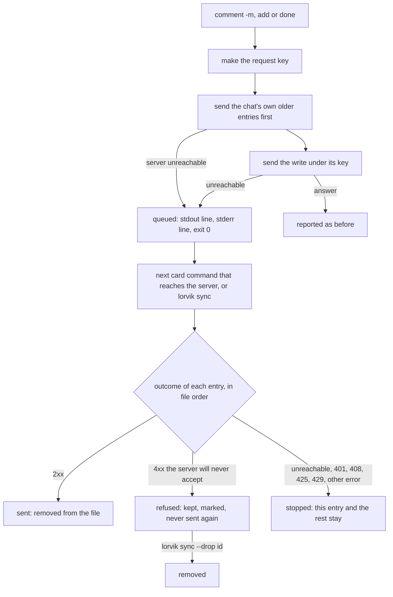

# Working through a server outage

## 1. Purpose

The `lorvik` CLI keeps working when the server cannot be reached. Three writes wait in a queue on the machine and go out later: `comment -m`, `add` and `done`. An agent can finish the card it holds and file new work; everything that needs the server to decide stays an error. A request key on every such write means a write whose reply was lost is never made twice.

## 2. Behaviour

### 2.1 What queues and what never does

Only these three commands queue (owner, #377). A claim or a question cannot be promised offline, so every other command fails as it did before the queue existed.

| Command | Waits in the queue | Why |
|---|---|---|
| `comment <n> -m` | yes | A note loses nothing by arriving late. |
| `add` | yes | New work is filed, never started or claimed. |
| `done <n>` | yes | The agent finishes the card it already holds. |
| `ask`, `start`, `claim`, `release`, `answer`, `edit`, `ready`, `drop` and every other command | no | The server decides, and the answer is needed now. They fail with the error they always gave. |
| `comment <n>` without `-m`, and every read | no | A read has nothing to send. |

"Unreachable" means a transport failure (`client.ConnError`, for example connection refused, a DNS failure, a TLS failure, or a reply that ends before its body is complete) or an HTTP 502, 503 or 504, and the command was not interrupted: Ctrl-C fails the command as before. Any other answer is reported as before and nothing is queued. A redirect the client does not follow (to another server, or the eleventh in a row) is an answer too: a portal or a proxy stands in front of a server that is not down, so the command fails with `refused a redirect to ...`. When the entry cannot be stored, the command fails with the original error.

A queued command:

- prints `queued  <what>  id <id>` on stdout, for example `queued  comment on #7  id 3J7K2QX4NVD5B6WYT0HMP9R8LC`, `queued  add "Fix login"  id ...` or `queued  done #12  id ...`; with `--json` it prints `{"queued":true,"id":...,"command":...}` plus `card` or `title`;
- prints `lorvik: cannot reach <server>: queued; lorvik sync sends it` on stderr;
- exits 0;
- prints no `holding` lines, because it did not reach the server.

### 2.2 Where the queue lives

One file per server and project: `<state>/lorvik/outbox/<host_port>/<project>.jsonl`, where `<state>` is `$XDG_STATE_HOME`, else `~/.local/state` (owner, #378). `<host_port>` is the server's host and port, lowercased, with every character outside `a-z`, `0-9`, `.` and `-` replaced by `_`. Directories are mode 0700 and the file 0600. The file is rewritten whole through a temporary file and a rename, under a lock file beside it (`<project>.jsonl.lock`) that is held to read and change entries and never across a request.

The queue never holds a token. An entry stores the server as `scheme://host[:port]`, without userinfo, path or query. A project slug that is not one safe path element cannot name a queue file.

An entry that did not change is written back exactly as it was read, so a field written by a newer CLI survives a rewrite by an older one. A temporary copy of the queue left behind by a killed write is removed by the next write.

One entry is one JSON line:

| Field | Meaning |
|---|---|
| `id` | The request key, also what `sync --drop` takes. |
| `at` | When it was queued. |
| `server`, `project` | The origin and the project slug it was queued for. |
| `owner` | Whose entry it is: `agent:<id>` for a harness agent; `env:<fingerprint>` when the token comes from `LORVIK_TOKEN`, which names nobody (the fingerprint is the first 8 hex digits of the token's SHA-256: it tells tokens apart and the token cannot be worked out from it); otherwise `config:<absolute path of the config file>`. |
| `session` | The chat's session label when it was queued; the entry is sent under this label. |
| `command` | `comment`, `add` or `done`. |
| `card`, `text` | A comment's card number and text. |
| `card`, `note`, `into`, `no_contract_change` | A `done`'s card number, comment, and fold. |
| `kind`, `title`, `body`, `page`, `priority`, `lane`, `parent`, `supersedes`, `ready`, `assignee`, `choices`, `blocks` | An `add`'s inputs. |
| `refused` | Set when the server refused the entry: `at`, `status`, `message`. |

An entry keeps the command's own inputs, not a built request, so sending it runs the code the command runs online. An `assignee` such as `me` is resolved when the entry is sent, not when it is queued.

### 2.3 What an agent may do while the server is down

An agent keeps working the card it holds until it is finished, and is told at first contact if it lost the card meanwhile (owner, #379). It files new work with `add`. It never starts or claims a card offline.

When the replayed `done` finds the card no longer held by this chat, it first sends the `done` under its key, without claiming:

- the first send was applied and only its reply was lost: the server knows the key and answers with the closed card. Nothing is claimed, even when the card was reopened or taken by someone since;
- its claim ran out and nobody took the card: the card is back in `ready`, so the server refuses the unclaimed `done` and its key stays free; the `done` claims the card again, then closes it under the same key, and says so on stderr;
- someone else holds it: the server refuses, the entry is marked refused and the chat is told (2.4).

### 2.4 Replay order and outcomes

Who sends what:

- The chat's next card command that reaches the server sends that chat's own entries first, in file order, once per process, and says so on stderr: `lorvik: sent queued <what>` (an `add` adds `as #N`) or `lorvik: queued <what> was refused: <message>; see lorvik sync --list`. "Own" means the same owner, the same session label, the same server and project, and not refused. When nothing is queued the cost is one `stat`. A card command is one that works on the project's cards, such as `next`, `ls`, `show`, `status`, `start`, `comment`, `add` and `done`. Commands that name no project's cards send nothing and print no notice: `inbox`, `search`, `ping`, `me`, `who`, `lock`, `note`, and the org, member, token and session commands.
- `lorvik sync` sends every entry of the same owner for this server and project, each under the session label that queued it. Entries of other owners, servers or projects are left alone and counted.
- After its automatic send, a command counts what of the same owner is still queued for this server and project and says so on stderr: `lorvik: queued writes: 2 waiting, 1 refused; lorvik sync sends what waits, lorvik sync --list shows them`. Waiting are entries only `sync` sends (another chat's, or one the send stopped at); refused are refusals from earlier runs. Nothing is printed when none is left, when the server was unreachable, or by `lorvik sync`, which prints its own account. The queue is outside the repo, so this line is the only place a write left by a chat that ended is seen (owner, #378).
- When the automatic send finds the server unreachable, the new write queues behind the older ones without a second attempt, so order holds and a dead server costs one timeout.

Outcome of each entry:

| Outcome | When | What happens to the entry | `sync` shows |
|---|---|---|---|
| sent | The server accepted it. | Removed. | `sent     <what>` |
| refused | A 4xx the server will never accept (a closed card, a card held by someone else, a missing right), or an input that no longer resolves. Not 401, 408, 425, 429 and not a stale card version. | Kept, marked with `status` and the server's words, never sent again. Removed only with `sync --drop <id>`. The next entry goes on. | `refused  <what>: <message>` |
| stopped | The server is unreachable again, 401, 408, 425, 429, a 5xx other than 502 to 504, or another error. | The entry and the rest stay. The stop line names the entry; for an error other than unreachable it adds `lorvik sync --drop <id> removes it`. | The stop line on stderr, exit with the stopping error's code. |

A stale card version on replay is retried once: the entry's own run read the card before it moved.

`lorvik sync` other forms and output:

| Form | Output |
|---|---|
| `sync` | One line per entry (`sent` or `refused`); then `kept     N refused entries; lorvik sync --list shows them, --drop removes one` for refusals from earlier runs, `waiting  N entries of other agents or people`, or `nothing queued`. |
| `sync --list` | `<id>  <ago>  <session>  <what>`, with `  (other)` for another owner, server or project and `  refused: <status> <message>` for a refused entry. `nothing queued` when empty. |
| `sync --drop <id>` | Removes the entry whoever queued it: `dropped  <what>`. An unknown id exits 3. |
| `sync --json` | `{"sent":[...],"refused":[...],"left":n,"others":n}`; items carry `id`, `command`, `card`, `title`, `number` (the card a sent `add` made), `status`, `message`. `--list --json` prints the entries; `--drop --json` prints `{"dropped":true,...}`. |
| `--list` and `--drop` together | Usage error. |

A line in the file that is not an entry is kept as it is, skipped when sending, and reported by `sync` and `sync --list` with its line number.

### 2.5 Known defects

- A person's entries are owned by the config file path. After signing in as another account into the same file, the old entries go out as the new account. Agents are keyed by agent id and are not affected.
- Entries queued under one `LORVIK_TOKEN` are another owner's once the variable holds a new token, also a new token of the same account: `sync --list` shows them as `(other)` and no command sends them. `sync --drop <id>` removes one; the write is then run again by hand.
- A refusal that would pass later (an agent whose access is given back, a card another chat holds and then releases) still marks the entry refused for good. The entry stays listed; the command is run again by hand.
- A DNS typo or a TLS failure in the API URL is a transport failure, so the write queues too. The stderr line names the server, which is how the typo is seen.
- When the automatic send stops on an error other than unreachable, the new command still runs and can overtake the stuck entry.
- Request keys are never pruned on the server (3, 4). An entry can wait any length of time, so the server keeps one small row per keyed write.

### 2.6 Intended changes

None.

## 3. Rules

- Only `comment -m`, `add` and `done` queue (#377).
- An entry is sent only by its owner, on its own server and project. Another owner's entry is never sent by this one; `sync --drop` is the one thing that reaches it. Two tokens in `LORVIK_TOKEN` are two owners.
- A refused entry is never sent again by any path.
- Request keys are per caller and work on the three routes named in `docs/api.md`. The key is answered before the body, the version or the caller's right is looked at, so a `done` whose first attempt was applied gets the card back, not a 409.
- No secret goes in the queue file: no token, no part of one, no userinfo in the server.
- A replayed `done` asks by its key before it claims, so an entry never takes a card that was reopened after its first send closed it.

## 4. Data

- The queue file (2.2). It is the only client-side state of this feature.
- Server table `request_keys`: one row per keyed write, primary key (actor kind, actor id, key). Columns hold the org, the project, the operation (`1` create card, `2` comment, `3` transition), the card created, moved or commented on, the subject (the card for operations 1 and 3, the comment for 2) and the time. The migration has the columns (`internal/store/migrations/00001_init.sql`); `domain.RequestKey` and `domain.ValidRequestKey` define the key (1 to 64 letters, digits, hyphen and underscore). Rows are never deleted.

## 5. API

No route of its own. The `Idempotency-Key` header on card create, comment and transition is in `docs/api.md`. CLI: `comment`, `add`, `done` and `sync`; `skills/lorvik/reference/commands.md` and `skills/lorvik/SKILL.md` tell agents what to do while the server is down.

## 6. Jobs

None. Nothing sends the queue in the background; a command or `lorvik sync` does.

## 7. Why it is this way

- Only three commands queue: a claim or a question cannot be promised offline (owner, #377).
- The queue is in the user state folder, one file per server and project (owner, #378), not in the repo: a worktree is its own folder, so a queue in the repo is deleted with the worktree, and a repo without the ignore line would commit it.
- An agent finishes the card it holds, and a lost card is found out when the `done` is replayed: the server claims it again if nobody took it and refuses if someone did (owner, #379).
- The entry's id is the request key, made before the first attempt, so a retry after a lost reply returns what the first request made. Keys never expire on the server because an entry can wait any length of time; the cost is one small row per keyed write.
- An entry stores the command's inputs, not a built request, so there is one code path for online and queued writes.
- A chat's command sends only that chat's own entries, and `lorvik sync` sends the rest. The other choice, any command sending every entry, would hand one chat the refusal of a `done` it never ran, for a card it does not know.
- A refused entry stays, marked with the server's words, and is never sent again; only `sync --drop` removes it, so nothing the agent believed was filed disappears without a trace.

Tests: `internal/cli/outbox_test.go` (queue, order, outcomes, `sync`), `internal/server/request_key_test.go` (keys), `internal/client/client_test.go` (a refused redirect, a reply cut off).
