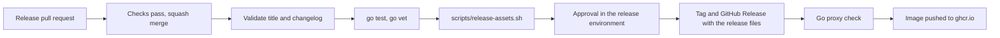

# Release: archives, installer and server image

## 1. Purpose

Ship Lorvik as versioned archives for the CLI and the server, a one-line installer for the CLI, and a container image for the server. GoReleaser builds everything at the release commit, and the organisation's shared release workflow publishes it; nothing is published without the owner's go.

## 2. Behaviour

### 2.1 What a release contains

Configured in `.goreleaser.yaml`. Targets are linux and darwin on amd64 and arm64, built with `CGO_ENABLED=0 -trimpath`. The linker stamps `internal/build.Version`, `.Commit` and `.Date` (same variables as the Taskfile `LDFLAGS`). The `toolchain` line in `go.mod` names the Go version that the workflows install and that compiles a release; the `go` line stays the floor for language features.

| Archive | Name | Contents |
|---|---|---|
| CLI | `lorvik_<os>_<arch>.tar.gz` | `lorvik`, `LICENSE-APACHE`, `cmd/lorvik/LICENSE`, `skills/**` |
| Server | `lorvikd_<version>_<os>_<arch>.tar.gz` | `lorvikd` (dashboard embedded), `LICENSE`, `LICENSING.md`, `deploy/compose/compose.yaml` |

Plus `checksums.txt` (sha256, one line per archive, both kinds). The CLI archive name carries no version so that `releases/latest/download/<asset>` resolves to it; the server archives keep the version.

The dashboard is built once by the `before` hooks (`bun install --frozen-lockfile`, then `bun run build`, both in `web/`), so every `lorvikd` carries it. The lockfile is frozen so a release never resolves a dependency afresh. A build without `web/dist` still compiles (`web/dist/.gitkeep` is committed) and ships an empty UI.

`task release:snapshot` runs GoReleaser with `--snapshot --clean --skip=publish` and writes `dist/` (git-ignored). It builds everything locally and publishes nothing. GoReleaser never publishes: its own changelog and release steps are off, because the notes come from `CHANGELOG.md` and the shared workflow creates the GitHub Release (2.5). The GoReleaser version is pinned in `scripts/release-assets.sh`, and the snapshot task reads it from there.

### 2.2 install.sh

`install.sh` at the repo root, POSIX `sh`, `set -eu`, no `sudo`. Usage: `sh install.sh [version]`.

- OS from `uname -s` (`linux`, `darwin`; anything else is refused). Arch from `uname -m` (`x86_64`/`amd64` to `amd64`, `aarch64`/`arm64` to `arm64`; anything else is refused).
- No version: `https://github.com/BonfireTrunk/lorvik/releases/latest/download/<asset>`. With a version (a tag such as `v0.3.0`): `.../releases/download/<version>/<asset>`.
- Downloads `lorvik_<os>_<arch>.tar.gz` and `checksums.txt` with `curl`, falling back to `wget`.
- Verifies the archive's sha256 against `checksums.txt` using `sha256sum` or `shasum -a 256`. A missing entry, a missing hash tool or a mismatch aborts before anything is installed.
- Extracts only `lorvik` and moves it into `${LORVIK_INSTALL_DIR:-$HOME/.local/bin}` (created if missing; replaced via a temp name in the same directory, so an upgrade never leaves a half-written binary).
- Prints the result of `lorvik version` and, when the directory is not on `PATH`, says so on stderr with the line to add.
- `LORVIK_DOWNLOAD_BASE` replaces the GitHub URL prefix with a directory, a `file://` URL or an http(s) prefix holding the archive and `checksums.txt`. It exists to test against a snapshot's `dist/`.

### 2.3 The server image

The runtime stage of `Dockerfile` is `gcr.io/distroless/static-debian13:nonroot` holding only `/lorvikd`. It runs as the distroless non-root user, `EXPOSE 8080`, `ENTRYPOINT ["/lorvikd"]`, `CMD ["serve"]`. The binary comes from one of two stages, chosen with the `BINARY` build arg:

| `BINARY` | Where the binary comes from | Used by |
|---|---|---|
| `source` (default) | `golang:1.27` (matches the `go` line in `go.mod`) builds it from the checkout with `CGO_ENABLED=0 -trimpath` and `VERSION`/`COMMIT` build args | `task docker:build`, local work |
| `released` | `linux_<arch>/lorvikd` in the build context, unpacked from a release archive | the release workflow (2.5) |

The published image is `ghcr.io/bonfiretrunk/lorvikd:<version>` for linux amd64 and arm64. No `latest` tag is pushed, and `deploy/compose/compose.yaml` requires `LORVIK_VERSION`, so an install never changes version on its own.

A `source` build does not build the dashboard: the build context's `web/dist` is embedded. Run `task web:build` before `task docker:build` (`docker build -t lorvikd:snapshot .` with `VERSION`/`COMMIT` build args). `.dockerignore` keeps `.git`, `bin/`, `dist/`, `tmp/` and `web/node_modules` out of the context but keeps `web/dist`.

Configuration is by environment variable, read by `internal/config` (prefix `LORVIK_`):

| Variable | Default | Meaning |
|---|---|---|
| `LORVIK_HTTP_ADDR` | `:8080` | listen address; change `EXPOSE`/port mapping with it |
| `LORVIK_DATABASE_URL` | none | Postgres connection string. Without it the server starts but has no store |
| `LORVIK_LOG_LEVEL` | `info` | `debug`, `info`, `warn`, `error` |
| `LORVIK_LOG_FORMAT` | `text` | `text` or `json` |
| `LORVIK_AUTO_MIGRATE` | `false` | apply pending migrations when `serve` starts |
| `LORVIK_SHUTDOWN_TIMEOUT` | `15s` | graceful shutdown bound |
| `LORVIK_DEV_UI_PROXY` | none | proxy the UI to a Vite dev server (development only) |
| `LORVIK_CORS_ORIGINS` | none | comma-separated browser origins allowed cross-origin |
| `LORVIK_AUTH_PASSWORD` | `false` | enable `POST /login` (see `docs/requirements/login.md`) |
| `LORVIK_GITHUB_CLIENT_ID`, `LORVIK_GITHUB_CLIENT_SECRET` | none | GitHub OAuth app; GitHub sign-in is on when both are set |
| `LORVIK_PUBLIC_URL` | derived per request | externally visible base URL, for OAuth redirects |
| `LORVIK_TRUSTED_PROXIES` | none | comma-separated IP addresses or CIDR ranges of the reverse proxies in front of the server. Set it when there is one: the sign-in limits then count each client by the address the proxy reports in `X-Forwarded-For`; without it every client behind the proxy shares one allowance, and the server logs one warning when it sees the header from an unlisted peer. A range covering every address is refused (`docs/requirements/login.md` 2.1a) |
| `LORVIK_BOOTSTRAP_PASSWORD` | none | read only by `lorvikd admin bootstrap`, not by `serve` |

Liveness: `GET /api/v1/healthz` answers 200 with `{"status","version","database"}`. `/healthz` without the prefix is served by the dashboard fallback and always answers 200, so it is not a health check.

### 2.4 Migrations

`lorvikd serve` does not migrate unless `LORVIK_AUTO_MIGRATE=true`. The default start is two steps against the same database:

1. `docker run --rm -e LORVIK_DATABASE_URL=... lorvikd:<tag> migrate up`
2. `docker run -d -p 8080:8080 -e LORVIK_DATABASE_URL=... lorvikd:<tag>`

Setting `LORVIK_AUTO_MIGRATE=true` collapses these into one for single-instance setups. `migrate up` is idempotent.

### 2.5 Releasing

A release follows the BonfireTrunk release contract. The shared workflows live in `BonfireTrunk/.github` and are pinned here to a reviewed full commit, never to a branch.

**Cutting a release**

1. Open a pull request into `prime` that renames the `## [Unreleased]` section of `CHANGELOG.md` to `## [X.Y.Z] - YYYY-MM-DD` and holds anything else the release needs.
2. Squash-merge it with the title `Release X.Y.Z`. `Release X.Y` means `X.Y.0`; `Release X.Y.Z-rc.1` makes a prerelease.
3. Approve the run in the `release` environment.

Nothing else starts a release. No one pushes a tag by hand: the workflow creates `vX.Y.Z` itself, and a version whose tag already exists on another commit is refused for good. Any other pull request must have a title that does not start with `Release `: the release run starts for every such commit on `prime` and fails when the rest is not a version.

The GitHub Release holds ten files: the eight archives, `checksums.txt`, and `release-go.zip`, the shared workflow's own record of the release.

**What runs**

| Workflow | Trigger | Jobs |
|---|---|---|
| `.github/workflows/build.yml` | every pull request | `build`: the shared `go-build.yml` (`go test`, `go vet`). `gate`: `task check`, the generated-code drift check, the store tests against Postgres, and `task release:snapshot`, which builds the dashboard from the frozen lockfile as a release does |
| `.github/workflows/cla.yml` | every pull request | the shared contributor-agreement check (`LICENSING.md`) |
| `.github/workflows/release.yml` | every branch push, and by hand | `release`: the shared `go-release.yml` with `assets-command: ./scripts/release-assets.sh`. `image`: pushes the server image. On a push that is not a release both end without doing anything |

`scripts/release-assets.sh` runs inside the shared workflow's build job, which holds a read-only token and no secrets. It receives `RELEASE_VERSION`, `RELEASE_TAG` and `RELEASE_ASSETS_DIR`, installs the bun version named in `web/package.json` when the machine has another, runs GoReleaser at its pinned version and leaves exactly the eight archives and `checksums.txt` in `RELEASE_ASSETS_DIR`. GoReleaser reads the version from a tag on HEAD, and the real tag does not exist yet at that point, so the script creates a local one, which is never pushed and is removed when the script ends. It stops if the build did not come out as `RELEASE_VERSION`. The shared workflow records each file's sha256, attaches the files to a draft release and only then publishes it.

The `image` job runs after the release is published. It finds the one `v*` tag on the release commit, downloads the two linux server archives and `checksums.txt` from the release, verifies them, and builds the image with `BINARY=released`, so the image runs the released bytes. It pushes `<version>-amd64` and `<version>-arm64` and joins them under `<version>`. A version that is already in the registry is left alone.

**Retrying**

| What failed | What to do |
|---|---|
| The build or the asset script | Nothing was tagged. Fix it in a new pull request and merge it under the same `Release X.Y.Z` title |
| Publishing, after the tag exists | "Re-run failed jobs" on the same run and approve again: it publishes the files that run already built. If that run's files have expired (30 days), run `release.yml` by hand from the tag: a release still in draft is built again and its files replaced, a published one is only verified |
| The Go proxy check, with the release already public | The release and its archives are out but the image job was skipped, so the image tag does not exist yet. "Re-run failed jobs" and approve again; the image follows |
| The image job | "Re-run failed jobs" on the same run: only the image job runs, with no new approval. By hand from the tag also works, after a new approval and proxy check |

**Repository settings the flow relies on**

The workflow files do not enforce these; the repository owner sets them once. The shared workflows are pinned by one commit id written in all three workflow files; a new pin changes all three.

| Setting | Value | Why |
|---|---|---|
| Visibility | public | the shared release workflow refuses a private repository, and the installer downloads without signing in |
| Environment `release` | required reviewers, limited to `prime` and `v*` tags | this is the approval gate; an environment without reviewers approves nothing |
| Ruleset on `prime` | pull requests only, squash merge, required checks `build / build`, `gate` and `cla / check` | only reviewed, green changes can become a release |
| Ruleset on `v*` tags | block update and delete, allow create | the workflow creates the tag; nobody can move it afterwards |
| Immutable releases | on | a published release and its files cannot be changed |
| Package `lorvikd` | public, after its first push | a new package starts private |

**The first release is a disposable one.** The flow has never run end to end, so the first run is a prerelease such as `0.4.0-rc.1`, made to prove it. Prereleases are not `latest`, so the installer ignores them.

## 3. Rules

- Nothing is published (tag, GitHub release, registry push) without the owner's explicit go: merging the release pull request and approving the run in the `release` environment. The environment guards the tag and the GitHub Release. The image registry accepts a push from any workflow run in the repository, so the image is guarded by who has write access.
- A published release, its files, its tag and its `<version>` image are never replaced. A bad release is followed by a patch release. Until `<version>` exists in the registry, a re-run of the image job may push the per-architecture `<version>-amd64` and `<version>-arm64` tags again.
- No job stores a registry token. The release job holds `contents: write`, the image job `packages: write`, and every other job is read-only.
- The installer never installs an archive whose sha256 does not match `checksums.txt`.
- The installer needs no privileges and never writes outside `LORVIK_INSTALL_DIR` and a temp directory it removes on exit.
- `skills/` and `cmd/lorvik` ship under Apache-2.0 in the CLI archive; server code under AGPL-3.0-only (`LICENSING.md`).

## 4. Data

None.

## 5. API

None, apart from the existing `GET /api/v1/healthz` used as the image's liveness check (`docs/api.md`).

## 6. Jobs

None.

## 7. Why it is this way

- GoReleaser over hand-rolled scripts: one config yields the cross-compiled archives and checksums, and `--snapshot` lets the whole build be tested without publishing. Rejected: a shell loop over `go build`, which would need its own checksum and archive code.
- Distroless `static` over alpine or scratch: a static Go binary needs no shell or package manager, the image is about 30 MB, and `nonroot` and CA certificates come with it. Scratch would lack CA certificates for outbound HTTPS (GitHub sign-in).
- No bun in the image: the UI is built once on the host and shared by the archives and the image, so the image build needs no Node toolchain and no network beyond Go modules.
- Migrations are not run on start by default: a failing migration should fail a deploy step, not crash-loop the server, and schema changes stay an explicit operator action. `LORVIK_AUTO_MIGRATE` stays available for single-instance use.
- The CLI archive has no version in its name: GitHub's `releases/latest/download/<asset>` redirect needs a fixed asset name, and it lets the installer find the latest release without an API call.
- The organisation's shared release workflow over one of Lorvik's own: its checks (title, changelog section, unused version, sealed file digests, proxy check) are reviewed once and shared by every repository. Rejected: a tag pushed by hand, which lets a typo or a tag on the wrong commit become a release.
- The archives are built inside the shared workflow's read-only job, not attached afterwards: with immutable releases nothing can be added once a release is published, and until it is, `releases/latest` must never point at a release without archives.
- The image is built from the released archives, not from source a second time: the registry then holds the same bytes the checksums cover, and the job needs neither Go nor bun.
- No `latest` image tag: an install that follows `latest` upgrades by itself, and an older patch release would move it backwards.
- A `toolchain` line in `go.mod`, not a higher `go` line: the workflows install exactly the Go that `go.mod` names and never switch to another, and GoReleaser needs a newer patch release than the feature floor. Raising the `go` line would raise the minimum for everyone who builds the module.
